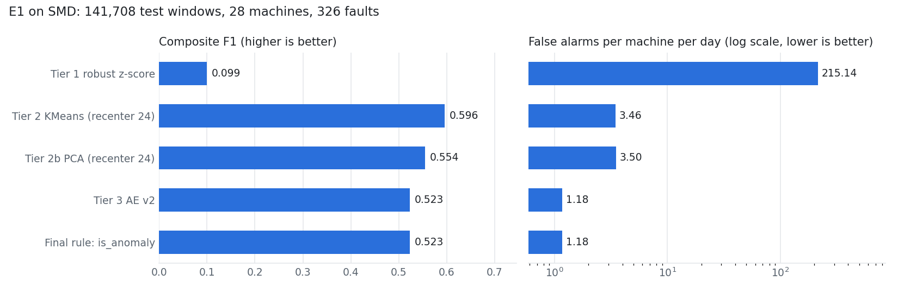

# E1: detection accuracy on SMD (all 28 machines)

Generated by `python src/detection/e1_report.py` from `data/scores/source=smd`.

## Method

**Data.** Server Machine Dataset (SMD), 28 machines, 38 metrics (`m00`..`m37`), one row per minute.
Each machine's train rows come first, then its test rows; only train rows are used to fit models and thresholds,
only test rows are scored here. **Windows.** 5-minute tumbling windows per machine (epoch-aligned); a window is
`test` if any of its rows is a test row, and its label is 1 if any row is labelled anomalous. This gives
141,708 test windows and 326 labelled faults (runs of consecutive anomalous windows).
**Thresholds.** KMeans, PCA and AE flag a window when its score exceeds the 99.5th percentile of their train
scores x 1.1, taken over all machines (PCA: 1.08172, read from `models/pca_smd/thresholds.json` because the scores layer
has no PCA flag). AE v2 also requires the score to exceed the 99th percentile of the machine's previous 288 scores.
**Recentring.** KMeans, PCA and AE v2 centre each test window on the median of the machine's previous 24 windows
(current window excluded) instead of the train mean; std stays from train and no labels are used. Tier 1 is v1
(robust z-score against the train median, flag if z > 3). **Final rule.** `is_anomaly = ae_flag` (contract rev C).
**Metrics** (`src/detection/evaluate.py`, scored per machine on time-ordered windows; machines joined by one
label-0/prediction-0 separator so no fault spans two machines; totals over machines):
composite F1 = harmonic mean of event recall (faults with at least one flagged window) and alarm precision
(point-wise precision of flagged windows, so every false alarm counts); false alarms per machine per day = flagged
normal windows / (windows x 5 min / 1 day); median detection delay = minutes from a detected fault's first window
to its first flagged window, over all detected faults; PR-AUC = average precision of the raw score pooled over
machines; point P/R/F1 = window-wise; event P/R/F1 (adj.) = point-adjusted (a hit anywhere in a fault credits the
whole fault), a generous reference only.

## Main table (test windows)

| detector | composite F1 | faults caught | alarm precision | false alarms / machine / day | median delay (min) | PR-AUC | point P | point R | point F1 | event P (adj.) | event R (adj.) | event F1 (adj.) | windows flagged |
| --- | ---: | ---: | ---: | ---: | ---: | ---: | ---: | ---: | ---: | ---: | ---: | ---: | ---: |
| Tier 1 robust z-score | 0.099 | 323/326 | 0.052 | 215.14 | 0 | 0.136 | 0.052 | 0.951 | 0.099 | 0.055 | 0.999 | 0.104 | 111,702 |
| Tier 2 KMeans (recenter 24) | 0.596 | 215/326 | 0.543 | 3.46 | 0 | 0.353 | 0.543 | 0.330 | 0.411 | 0.757 | 0.866 | 0.808 | 3,732 |
| Tier 2b PCA (recenter 24) | 0.554 | 183/326 | 0.547 | 3.50 | 0 | 0.352 | 0.547 | 0.339 | 0.419 | 0.727 | 0.748 | 0.737 | 3,806 |
| Tier 3 AE v2 | 0.523 | 179/326 | 0.500 | 1.18 | 0 | 0.355 | 0.500 | 0.094 | 0.158 | 0.891 | 0.773 | 0.828 | 1,157 |
| Final rule: is_anomaly | 0.523 | 179/326 | 0.500 | 1.18 | 0 | 0.355 | 0.500 | 0.094 | 0.158 | 0.891 | 0.773 | 0.828 | 1,157 |



## Findings

On the 141,708 test windows, Tier 2 KMeans (recenter 24) has the highest composite F1 (0.596), followed by Tier 2b PCA (recenter 24) (0.554), Tier 3 AE v2 (0.523), Tier 1 robust z-score (0.099). The AE v2 alarm catches 179/326 faults at 1.18 false alarms per machine per day, while KMeans and PCA (recenter 24) catch 215 and 183 faults at 3.46 and 3.50, so the higher composite F1 comes with more false alarms and E1 alone does not settle which alarm to use; AE v2 also runs with `--adaptive 288` (score must exceed the 99th percentile of the machine's previous 288 scores), which KMeans and PCA do not have. Tier 1 v1 catches 323/326 faults but flags 111,702 of 141,708 windows (215.1 false alarms per machine per day), which is why it is kept as a baseline and explainer, not part of the alarm. Per machine, the best single detector by composite F1 is Tier 1 robust z-score on 0, Tier 2 KMeans (recenter 24) on 15, Tier 2b PCA (recenter 24) on 6, Tier 3 AE v2 on 7 of the 28 machines (ties go to the first listed), so no detector is best everywhere. Point-adjusted event F1 is at least as high as composite F1 for every detector because one hit credits the whole fault; it is shown only as a reference. All numbers come from one test split of one dataset (SMD), with thresholds fixed from train data before the test windows were scored.

## Notes on small differences

- AE v2 here is 0.523 composite F1 / 179 faults caught / 1,157 windows flagged, against 0.525 / 180 / 1,158 in
  `docs/results/tier1_stream.md`, because the AE was retrained on this laptop (seed 42; PyTorch CPU results differ
  slightly across machines). Every row in this table is scored from the same scores layer, so all of them use this
  same model.
- Tier 1's 111,702 flagged windows are counted over all 141,708 batch test windows, while `tier1_stream.md` counts
  111,674 for `ae_flag OR tier1_flag` over the 141,624 stream-matched windows (the 84 newest windows are still open
  in the stream's state).

## Composite F1 per machine

| machine | Tier 1 robust z-score | Tier 2 KMeans (recenter 24) | Tier 2b PCA (recenter 24) | Tier 3 AE v2 | Final rule: is_anomaly |
| --- | ---: | ---: | ---: | ---: | ---: |
| machine-1-1 | 0.208 | 0.788 | 0.897 | 0.661 | 0.661 |
| machine-1-2 | 0.072 | 0.727 | 0.467 | 0.486 | 0.486 |
| machine-1-3 | 0.071 | 0.340 | 0.236 | 0.274 | 0.274 |
| machine-1-4 | 0.063 | 0.443 | 0.278 | 0.384 | 0.384 |
| machine-1-5 | 0.016 | 0.339 | 0.248 | 0.496 | 0.496 |
| machine-1-6 | 0.289 | 0.644 | 0.754 | 0.543 | 0.543 |
| machine-1-7 | 0.269 | 0.741 | 0.648 | 0.688 | 0.688 |
| machine-1-8 | 0.068 | 0.515 | 0.366 | 0.397 | 0.397 |
| machine-2-1 | 0.114 | 0.730 | 0.726 | 0.674 | 0.674 |
| machine-2-2 | 0.284 | 0.551 | 0.371 | 0.391 | 0.391 |
| machine-2-3 | 0.030 | 0.852 | 0.840 | 0.774 | 0.774 |
| machine-2-4 | 0.204 | 0.181 | 0.095 | 0.594 | 0.594 |
| machine-2-5 | 0.216 | 0.885 | 0.920 | 0.878 | 0.878 |
| machine-2-6 | 0.037 | 0.523 | 0.562 | 0.588 | 0.588 |
| machine-2-7 | 0.074 | 0.396 | 0.235 | 0.500 | 0.500 |
| machine-2-8 | 0.016 | 0.582 | 0.703 | 0.478 | 0.478 |
| machine-2-9 | 0.120 | 0.786 | 0.782 | 0.561 | 0.561 |
| machine-3-1 | 0.025 | 0.839 | 0.725 | 0.764 | 0.764 |
| machine-3-10 | 0.094 | 0.336 | 0.262 | 0.293 | 0.293 |
| machine-3-11 | 0.027 | 0.185 | 0.231 | 0.508 | 0.508 |
| machine-3-2 | 0.092 | 0.625 | 0.333 | 0.500 | 0.500 |
| machine-3-3 | 0.075 | 0.706 | 0.304 | 0.309 | 0.309 |
| machine-3-4 | 0.086 | 0.698 | 0.752 | 0.304 | 0.304 |
| machine-3-5 | 0.041 | 0.308 | 0.283 | 0.348 | 0.348 |
| machine-3-6 | 0.097 | 0.698 | 0.700 | 0.728 | 0.728 |
| machine-3-7 | 0.035 | 0.704 | 0.749 | 0.439 | 0.439 |
| machine-3-8 | 0.096 | 0.473 | 0.466 | 0.403 | 0.403 |
| machine-3-9 | 0.024 | 0.696 | 0.605 | 0.696 | 0.696 |

## Reference rows (earlier runs, quoted, not recomputed)

| detector | metric | value | faults caught | false alarms / machine / day | source |
| --- | --- | ---: | ---: | ---: | --- |
| Tier 2 KMeans, recenter 0 | composite F1 | 0.266 | 225/326 | 31.47 | PR #9 |
| Tier 2b PCA, recenter 0 | composite F1 | 0.246 | 195/326 | 30.15 | PR #9 |
| Tier 3 AE v1 | point-adjusted event F1 (generous) | 0.360 | 222/326 | 36.98 | PR #6 (composite F1 0.236 in the v1 rerun, docs/ae_ablation.md) |
| Tier 1 v2, best setting (k = 3, t = 6) | composite F1 | 0.338 | 150/326 | 9.40 | PR #15, docs/results/tier1_stream.md (not selected: above 2 false alarms per machine per day) |

## Reproduce

```
python src/detection/e1_report.py      # reads data/scores/source=smd, writes docs/results/e1.md/.json/.png
```
