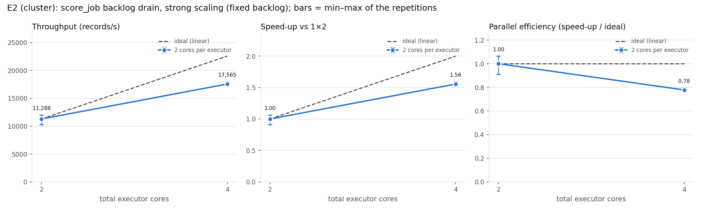

# E2 (cluster): scaling of the stream scoring job (backlog drain)

Setup: for each config, `infra/cluster/drain_test.sh` recreates `telemetry.smd`, replays the backlog at max speed
with score_job **not** running, then starts score_job (`submit.sh -e E -c C`, `--reset`, trigger `0 seconds`,
`maxOffsetsPerTrigger = 200,000`) and times how long it takes to consume it; strong scaling: the same backlog of 2,000,000 records for every config, `replicate = 4` copies of every machine (112 keys).
Topic `telemetry.smd` recreated with **32 partitions**; `spark.sql.shuffle.partitions` = 2 × total cores (unless overridden). The per-config values of replicate, topic partitions and shuffle partitions are in the table.
3 repetitions per config (interleaved), mean with min–max in brackets.
Cluster: Azure India South Central: spark-master D2as_v4 (Kafka, NFS, driver); workers D2as_v4/E2as_v4, 2 vCPU + 4 GB Spark each. Measured 2026-11-15 with
`python experiments/e2_scaling_sweep.py --configs 1x2 2x2 --repeats 3 --cluster Azure India South Central: spark-master D2as_v4 (Kafka, NFS, driver); workers D2as_v4/E2as_v4, 2 vCPU + 4 GB Spark each`.

- **drain time**: start of the first micro-batch with input rows → end of the last one (job start-up excluded);
  **records/s** = backlog / drain time; **steady records/s** = the same without the first batch (it pays the
  Python workers' torch import and model load).
- **speed-up** = records/s / records/s of 1 × 2;
  **ideal** = total cores / 2; **efficiency** = speed-up / ideal.
- **batches**, **batch mean / p95**: micro-batches with input rows and their `triggerExecution` durations;
  **executors seen**: distinct executor ids in the driver's Spark UI during the run.

| executors × cores | total cores | replicate | topic partitions | shuffle partitions | runs drained | drain time (s) | records/s | steady records/s | speed-up | ideal | efficiency | batches | batch mean (s) | batch p95 (s) | executors seen |
| --- | ---: | ---: | ---: | ---: | ---: | ---: | ---: | ---: | ---: | ---: | ---: | ---: | ---: | ---: | ---: |
| 1 × 2 | 2 | 4 | 32 | 4 | 3/3 | 178.0 (166.5–194.8) | 11,288 (10,266–12,012) | 13,427 (12,367–14,149) | 1.00 (0.91–1.06) | 1.00 | 1.00 (0.91–1.06) | 11 | 16.18 | 43.47 | 1 |
| 2 × 2 | 4 | 4 | 32 | 8 | 3/3 | 113.9 (111.2–116.1) | 17,565 (17,226–17,988) | 22,402 (21,972–22,734) | 1.56 (1.53–1.59) | 2.00 | 0.78 (0.76–0.80) | 11 | 10.35 | 33.53 | 2 |

Highest throughput: 2 × 2 (4 cores), 17,565 records/s, 1.56× the base config. At 4 cores the parallel efficiency is 0.78.

## Every run

| run | status | replicate | topic partitions | shuffle partitions | records | drain (s) | records/s | batches | batch mean (s) | batch p95 (s) | executors seen |
| --- | --- | ---: | ---: | ---: | ---: | ---: | ---: | ---: | ---: | ---: | ---: |
| e2_20261115T124801Z_e1c2_rep1 | drained | 4 | 32 | 4 | 2,000,000 | 166.5 | 12,012 | 11 | 15.13 | 39.28 | 1 |
| e2_20261115T124801Z_e2c2_rep1 | drained | 4 | 32 | 8 | 2,000,000 | 114.4 | 17,481 | 11 | 10.40 | 32.49 | 2 |
| e2_20261115T124801Z_e1c2_rep2 | drained | 4 | 32 | 4 | 2,000,000 | 194.8 | 10,266 | 11 | 17.71 | 49.26 | 1 |
| e2_20261115T124801Z_e2c2_rep2 | drained | 4 | 32 | 8 | 2,000,000 | 116.1 | 17,226 | 11 | 10.55 | 36.10 | 2 |
| e2_20261115T124801Z_e1c2_rep3 | drained | 4 | 32 | 4 | 2,000,000 | 172.6 | 11,586 | 11 | 15.69 | 41.86 | 1 |
| e2_20261115T124801Z_e2c2_rep3 | drained | 4 | 32 | 8 | 2,000,000 | 111.2 | 17,988 | 11 | 10.11 | 32.01 | 2 |
