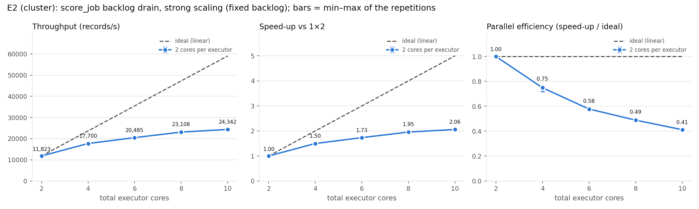

# E2 (cluster): scaling of the stream scoring job (backlog drain)

Setup: for each config, `infra/cluster/drain_test.sh` recreates `telemetry.smd`, replays the backlog at max speed
with score_job **not** running, then starts score_job (`submit.sh -e E -c C`, `--reset`, trigger `0 seconds`,
`maxOffsetsPerTrigger = 200,000`) and times how long it takes to consume it; strong scaling: the same backlog of 2,000,000 records for every config, `replicate = 4` copies of every machine (112 keys).
Topic `telemetry.smd` recreated with **32 partitions**; `spark.sql.shuffle.partitions` = 2 × total cores (unless overridden). The per-config values of replicate, topic partitions and shuffle partitions are in the table.
3 repetitions per config (interleaved), mean with min–max in brackets.
Cluster: Azure India South Central, 2 subscriptions joined by VNet peering: spark-master D2as_v4 (Kafka, NFS, driver); 5 workers (3 D2as_v4, 2 E2as_v4), 2 vCPU + 4 GB Spark each. Measured 2026-11-15 with
`python experiments/e2_scaling_sweep.py --configs 1x2 2x2 3x2 4x2 5x2 --repeats 3 --cluster Azure India South Central, 2 subscriptions joined by VNet peering: spark-master D2as_v4 (Kafka, NFS, driver); 5 workers (3 D2as_v4, 2 E2as_v4), 2 vCPU + 4 GB Spark each`.

- **drain time**: start of the first micro-batch with input rows → end of the last one (job start-up excluded);
  **records/s** = backlog / drain time; **steady records/s** = the same without the first batch (it pays the
  Python workers' torch import and model load).
- **speed-up** = records/s / records/s of 1 × 2;
  **ideal** = total cores / 2; **efficiency** = speed-up / ideal.
- **batches**, **batch mean / p95**: micro-batches with input rows and their `triggerExecution` durations;
  **executors seen**: distinct executor ids in the driver's Spark UI during the run.

| executors × cores | total cores | replicate | topic partitions | shuffle partitions | runs drained | drain time (s) | records/s | steady records/s | speed-up | ideal | efficiency | batches | batch mean (s) | batch p95 (s) | executors seen |
| --- | ---: | ---: | ---: | ---: | ---: | ---: | ---: | ---: | ---: | ---: | ---: | ---: | ---: | ---: | ---: |
| 1 × 2 | 2 | 4 | 32 | 4 | 3/3 | 169.2 (168.4–170.4) | 11,823 (11,736–11,876) | 13,784 (13,572–14,057) | 1.00 (0.99–1.00) | 1.00 | 1.00 (0.99–1.00) | 11 | 15.38 | 38.55 | 1 |
| 2 × 2 | 4 | 4 | 32 | 8 | 3/3 | 113.1 (110.4–117.8) | 17,700 (16,980–18,114) | 22,309 (21,324–22,809) | 1.50 (1.44–1.53) | 2.00 | 0.75 (0.72–0.77) | 11 | 10.28 | 32.33 | 2 |
| 3 × 2 | 6 | 4 | 32 | 12 | 3/3 | 97.7 (95.8–99.4) | 20,485 (20,128–20,883) | 26,896 (26,181–27,973) | 1.73 (1.70–1.77) | 3.00 | 0.58 (0.57–0.59) | 11 | 8.87 | 30.67 | 3 |
| 4 × 2 | 8 | 4 | 32 | 16 | 3/3 | 86.6 (84.6–88.3) | 23,108 (22,644–23,632) | 30,342 (29,750–31,234) | 1.95 (1.92–2.00) | 4.00 | 0.49 (0.48–0.50) | 11 | 7.87 | 27.23 | 4 |
| 5 × 2 | 10 | 4 | 32 | 20 | 3/3 | 82.2 (80.9–83.0) | 24,342 (24,097–24,712) | 32,374 (32,045–32,955) | 2.06 (2.04–2.09) | 5.00 | 0.41 (0.41–0.42) | 11 | 7.47 | 26.56 | 5 |

Highest throughput: 5 × 2 (10 cores), 24,342 records/s, 2.06× the base config. At 10 cores the parallel efficiency is 0.41.

## Every run

| run | status | replicate | topic partitions | shuffle partitions | records | drain (s) | records/s | batches | batch mean (s) | batch p95 (s) | executors seen |
| --- | --- | ---: | ---: | ---: | ---: | ---: | ---: | ---: | ---: | ---: | ---: |
| e2_20261115T135530Z_e1c2_rep1 | drained | 4 | 32 | 4 | 2,000,000 | 170.4 | 11,736 | 11 | 15.49 | 37.79 | 1 |
| e2_20261115T135530Z_e2c2_rep1 | drained | 4 | 32 | 8 | 2,000,000 | 117.8 | 16,980 | 11 | 10.71 | 33.37 | 2 |
| e2_20261115T135530Z_e3c2_rep1 | drained | 4 | 32 | 12 | 2,000,000 | 99.4 | 20,128 | 11 | 9.03 | 30.61 | 3 |
| e2_20261115T135530Z_e4c2_rep1 | drained | 4 | 32 | 16 | 2,000,000 | 84.6 | 23,632 | 11 | 7.69 | 27.00 | 4 |
| e2_20261115T135530Z_e5c2_rep1 | drained | 4 | 32 | 20 | 2,000,000 | 83.0 | 24,097 | 11 | 7.54 | 26.83 | 5 |
| e2_20261115T135530Z_e1c2_rep2 | drained | 4 | 32 | 4 | 2,000,000 | 168.4 | 11,876 | 11 | 15.31 | 37.26 | 1 |
| e2_20261115T135530Z_e2c2_rep2 | drained | 4 | 32 | 8 | 2,000,000 | 111.1 | 18,005 | 11 | 10.10 | 32.17 | 2 |
| e2_20261115T135530Z_e3c2_rep2 | drained | 4 | 32 | 12 | 2,000,000 | 95.8 | 20,883 | 11 | 8.70 | 31.42 | 3 |
| e2_20261115T135530Z_e4c2_rep2 | drained | 4 | 32 | 16 | 2,000,000 | 86.8 | 23,047 | 11 | 7.88 | 26.86 | 4 |
| e2_20261115T135530Z_e5c2_rep2 | drained | 4 | 32 | 20 | 2,000,000 | 80.9 | 24,712 | 11 | 7.35 | 26.31 | 5 |
| e2_20261115T135530Z_e1c2_rep3 | drained | 4 | 32 | 4 | 2,000,000 | 168.7 | 11,857 | 11 | 15.33 | 40.62 | 1 |
| e2_20261115T135530Z_e2c2_rep3 | drained | 4 | 32 | 8 | 2,000,000 | 110.4 | 18,114 | 11 | 10.03 | 31.44 | 2 |
| e2_20261115T135530Z_e3c2_rep3 | drained | 4 | 32 | 12 | 2,000,000 | 97.8 | 20,445 | 11 | 8.89 | 29.98 | 3 |
| e2_20261115T135530Z_e4c2_rep3 | drained | 4 | 32 | 16 | 2,000,000 | 88.3 | 22,644 | 11 | 8.03 | 27.82 | 4 |
| e2_20261115T135530Z_e5c2_rep3 | drained | 4 | 32 | 20 | 2,000,000 | 82.6 | 24,217 | 11 | 7.50 | 26.55 | 5 |
