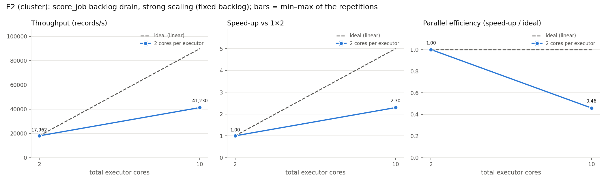

# E2 (cluster): scaling of the stream scoring job (backlog drain)

Setup: for each config, `infra/cluster/drain_test.sh` recreates `telemetry.smd`, replays the backlog at max speed
with score_job **not** running, then starts score_job (`submit.sh -e E -c C`, `--reset`, trigger `0 seconds`,
`maxOffsetsPerTrigger = 800,000`) and times how long it takes to consume it; strong scaling: the same backlog of 4,000,000 records for every config, `replicate = 4` copies of every machine (112 keys).
Topic `telemetry.smd` recreated with **32 partitions**; `spark.sql.shuffle.partitions` = 2 × total cores (unless overridden). The per-config values of replicate, topic partitions and shuffle partitions are in the table.
2 repetitions per config (interleaved), mean with min–max in brackets.
Cluster: Azure India South Central, 2 subscriptions joined by VNet peering: spark-master D2as_v4 (Kafka, NFS, driver); 5 workers (3 D2as_v4, 2 E2as_v4), 2 vCPU + 4 GB Spark each. Measured 2026-11-15 with
`python experiments/e2_scaling_sweep.py --configs 1x2 5x2 --repeats 2 --records 4000000 --max-offsets-per-trigger 800000 --cluster Azure India South Central, 2 subscriptions joined by VNet peering: spark-master D2as_v4 (Kafka, NFS, driver); 5 workers (3 D2as_v4, 2 E2as_v4), 2 vCPU + 4 GB Spark each`.

- **drain time**: start of the first micro-batch with input rows → end of the last one (job start-up excluded);
  **records/s** = backlog / drain time; **steady records/s** = the same without the first batch (it pays the
  Python workers' torch import and model load).
- **speed-up** = records/s / records/s of 1 × 2;
  **ideal** = total cores / 2; **efficiency** = speed-up / ideal.
- **batches**, **batch mean / p95**: micro-batches with input rows and their `triggerExecution` durations;
  **executors seen**: distinct executor ids in the driver's Spark UI during the run.

| executors × cores | total cores | replicate | topic partitions | shuffle partitions | runs drained | drain time (s) | records/s | steady records/s | speed-up | ideal | efficiency | batches | batch mean (s) | batch p95 (s) | executors seen |
| --- | ---: | ---: | ---: | ---: | ---: | ---: | ---: | ---: | ---: | ---: | ---: | ---: | ---: | ---: | ---: |
| 1 × 2 | 2 | 4 | 32 | 4 | 2/2 | 222.7 (220.8–224.6) | 17,962 (17,808–18,116) | 20,133 (19,801–20,464) | 1.00 (0.99–1.01) | 1.00 | 1.00 (0.99–1.01) | 6 | 37.11 | 63.72 | 1 |
| 5 × 2 | 10 | 4 | 32 | 20 | 2/2 | 97.1 (94.9–99.3) | 41,230 (40,296–42,164) | 55,557 (53,221–57,893) | 2.30 (2.24–2.35) | 5.00 | 0.46 (0.45–0.47) | 6 | 16.17 | 39.36 | 5 |

Highest throughput: 5 × 2 (10 cores), 41,230 records/s, 2.30× the base config. At 10 cores the parallel efficiency is 0.46.

## Every run

| run | status | replicate | topic partitions | shuffle partitions | records | drain (s) | records/s | batches | batch mean (s) | batch p95 (s) | executors seen |
| --- | --- | ---: | ---: | ---: | ---: | ---: | ---: | ---: | ---: | ---: | ---: |
| e2_20261115T145300Z_e1c2_rep1 | drained | 4 | 32 | 4 | 4,000,000 | 224.6 | 17,808 | 6 | 37.43 | 63.01 | 1 |
| e2_20261115T145300Z_e5c2_rep1 | drained | 4 | 32 | 20 | 4,000,000 | 99.3 | 40,296 | 6 | 16.54 | 39.14 | 5 |
| e2_20261115T145300Z_e1c2_rep2 | drained | 4 | 32 | 4 | 4,000,000 | 220.8 | 18,116 | 6 | 36.80 | 64.43 | 1 |
| e2_20261115T145300Z_e5c2_rep2 | drained | 4 | 32 | 20 | 4,000,000 | 94.9 | 42,164 | 6 | 15.81 | 39.59 | 5 |
