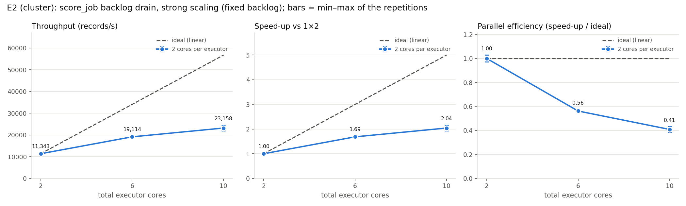

# E2 (cluster): scaling of the stream scoring job (backlog drain)

Setup: for each config, `infra/cluster/drain_test.sh` recreates `telemetry.smd`, replays the backlog at max speed
with score_job **not** running, then starts score_job (`submit.sh -e E -c C`, `--reset`, trigger `0 seconds`,
`maxOffsetsPerTrigger = 200,000`) and times how long it takes to consume it; strong scaling: the same backlog of 2,000,000 records for every config, `replicate = 4` copies of every machine (112 keys).
Topic `telemetry.smd` recreated with **32 partitions**; `spark.sql.shuffle.partitions` = 2 × total cores (unless overridden). The per-config values of replicate, topic partitions and shuffle partitions are in the table.
**Experiment localckpt:** checkpoint root `/tmp/ckpt-{run_id}` (each node's local disk, `--allow-local-checkpoint`).
2 repetitions per config (interleaved), mean with min–max in brackets.
Cluster: Azure India South Central, 2 subscriptions joined by VNet peering: spark-master D2as_v4 (Kafka, NFS, driver); 5 workers (3 D2as_v4, 2 E2as_v4), 2 vCPU + 4 GB Spark each. Measured 2026-11-17 with
`python experiments/e2_scaling_sweep.py --configs 1x2 3x2 5x2 --repeats 2 --tag localckpt --checkpoint-dir /tmp/ckpt-{run_id} --allow-local-checkpoint --cluster Azure India South Central, 2 subscriptions joined by VNet peering: spark-master D2as_v4 (Kafka, NFS, driver); 5 workers (3 D2as_v4, 2 E2as_v4), 2 vCPU + 4 GB Spark each`.

- **drain time**: start of the first micro-batch with input rows → end of the last one (job start-up excluded);
  **records/s** = backlog / drain time; **steady records/s** = the same without the first batch (it pays the
  Python workers' torch import and model load).
- **speed-up** = records/s / records/s of 1 × 2;
  **ideal** = total cores / 2; **efficiency** = speed-up / ideal.
- **batches**, **batch mean / p95**: micro-batches with input rows and their `triggerExecution` durations;
  **executors seen**: distinct executor ids in the driver's Spark UI during the run.

| executors × cores | total cores | replicate | topic partitions | shuffle partitions | runs drained | drain time (s) | records/s | steady records/s | speed-up | ideal | efficiency | batches | batch mean (s) | batch p95 (s) | executors seen |
| --- | ---: | ---: | ---: | ---: | ---: | ---: | ---: | ---: | ---: | ---: | ---: | ---: | ---: | ---: | ---: |
| 1 × 2 | 2 | 4 | 32 | 4 | 2/2 | 176.5 (171.5–181.4) | 11,343 (11,026–11,660) | 13,851 (13,597–14,105) | 1.00 (0.97–1.03) | 1.00 | 1.00 (0.97–1.03) | 11 | 16.04 | 46.46 | 1 |
| 3 × 2 | 6 | 4 | 32 | 12 | 2/2 | 104.7 (102.3–107.1) | 19,114 (18,671–19,556) | 24,882 (24,566–25,198) | 1.69 (1.65–1.72) | 3.00 | 0.56 (0.55–0.57) | 11 | 9.51 | 32.34 | 3 |
| 5 × 2 | 10 | 4 | 32 | 20 | 2/2 | 86.6 (81.8–91.5) | 23,158 (21,859–24,456) | 31,934 (31,609–32,259) | 2.04 (1.93–2.16) | 5.00 | 0.41 (0.39–0.43) | 11 | 7.87 | 30.26 | 5 |

Highest throughput: 5 × 2 (10 cores), 23,158 records/s, 2.04× the base config. At 10 cores the parallel efficiency is 0.41.

## Every run

| run | status | replicate | topic partitions | shuffle partitions | records | drain (s) | records/s | batches | batch mean (s) | batch p95 (s) | executors seen |
| --- | --- | ---: | ---: | ---: | ---: | ---: | ---: | ---: | ---: | ---: | ---: |
| e2_localckpt_20261117T152216Z_e1c2_rep1 | drained | 4 | 32 | 4 | 2,000,000 | 181.4 | 11,026 | 11 | 16.49 | 53.77 | 1 |
| e2_localckpt_20261117T152216Z_e3c2_rep1 | drained | 4 | 32 | 12 | 2,000,000 | 107.1 | 18,671 | 11 | 9.74 | 35.68 | 3 |
| e2_localckpt_20261117T152216Z_e5c2_rep1 | drained | 4 | 32 | 20 | 2,000,000 | 91.5 | 21,859 | 11 | 8.32 | 34.55 | 5 |
| e2_localckpt_20261117T152216Z_e1c2_rep2 | drained | 4 | 32 | 4 | 2,000,000 | 171.5 | 11,660 | 11 | 15.59 | 39.15 | 1 |
| e2_localckpt_20261117T152216Z_e3c2_rep2 | drained | 4 | 32 | 12 | 2,000,000 | 102.3 | 19,556 | 11 | 9.29 | 29.00 | 3 |
| e2_localckpt_20261117T152216Z_e5c2_rep2 | drained | 4 | 32 | 20 | 2,000,000 | 81.8 | 24,456 | 11 | 7.43 | 25.98 | 5 |
