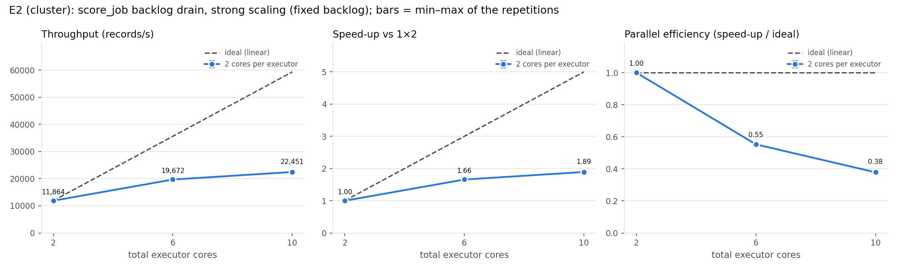

# E2 (cluster): scaling of the stream scoring job (backlog drain)

Setup: for each config, `infra/cluster/drain_test.sh` recreates `telemetry.smd`, replays the backlog at max speed
with score_job **not** running, then starts score_job (`submit.sh -e E -c C`, `--reset`, trigger `0 seconds`,
`maxOffsetsPerTrigger = 200,000`) and times how long it takes to consume it; strong scaling: the same backlog of 2,000,000 records for every config, `replicate = 4` copies of every machine (112 keys).
Topic `telemetry.smd` recreated with **32 partitions**; `spark.sql.shuffle.partitions` = 2 × total cores (unless overridden). The per-config values of replicate, topic partitions and shuffle partitions are in the table.
**Experiment minpart40:** score_job extra args `--min-partitions 40`.
2 repetitions per config (interleaved), mean with min–max in brackets.
Cluster: Azure India South Central, 2 subscriptions joined by VNet peering: spark-master D2as_v4 (Kafka, NFS, driver); 5 workers (3 D2as_v4, 2 E2as_v4), 2 vCPU + 4 GB Spark each. Measured 2026-11-17 with
`python experiments/e2_scaling_sweep.py --configs 1x2 3x2 5x2 --repeats 2 --tag minpart40 --job-args=--min-partitions 40 --cluster Azure India South Central, 2 subscriptions joined by VNet peering: spark-master D2as_v4 (Kafka, NFS, driver); 5 workers (3 D2as_v4, 2 E2as_v4), 2 vCPU + 4 GB Spark each`.

- **drain time**: start of the first micro-batch with input rows → end of the last one (job start-up excluded);
  **records/s** = backlog / drain time; **steady records/s** = the same without the first batch (it pays the
  Python workers' torch import and model load).
- **speed-up** = records/s / records/s of 1 × 2;
  **ideal** = total cores / 2; **efficiency** = speed-up / ideal.
- **batches**, **batch mean / p95**: micro-batches with input rows and their `triggerExecution` durations;
  **executors seen**: distinct executor ids in the driver's Spark UI during the run.

| executors × cores | total cores | replicate | topic partitions | shuffle partitions | runs drained | drain time (s) | records/s | steady records/s | speed-up | ideal | efficiency | batches | batch mean (s) | batch p95 (s) | executors seen |
| --- | ---: | ---: | ---: | ---: | ---: | ---: | ---: | ---: | ---: | ---: | ---: | ---: | ---: | ---: | ---: |
| 1 × 2 | 2 | 4 | 32 | 4 | 2/2 | 168.6 (167.8–169.4) | 11,864 (11,808–11,919) | 13,690 (13,598–13,783) | 1.00 (1.00–1.00) | 1.00 | 1.00 (1.00–1.00) | 11 | 15.32 | 37.10 | 1 |
| 3 × 2 | 6 | 4 | 32 | 12 | 2/2 | 101.7 (100.6–102.8) | 19,672 (19,460–19,883) | 25,136 (24,702–25,570) | 1.66 (1.64–1.68) | 3.00 | 0.55 (0.55–0.56) | 11 | 9.24 | 30.05 | 3 |
| 5 × 2 | 10 | 4 | 32 | 20 | 2/2 | 89.2 (86.4–92.0) | 22,451 (21,744–23,159) | 28,832 (27,684–29,979) | 1.89 (1.83–1.95) | 5.00 | 0.38 (0.37–0.39) | 11 | 8.10 | 26.64 | 5 |

Highest throughput: 5 × 2 (10 cores), 22,451 records/s, 1.89× the base config. At 10 cores the parallel efficiency is 0.38.

## Every run

| run | status | replicate | topic partitions | shuffle partitions | records | drain (s) | records/s | batches | batch mean (s) | batch p95 (s) | executors seen |
| --- | --- | ---: | ---: | ---: | ---: | ---: | ---: | ---: | ---: | ---: | ---: |
| e2_minpart40_20261117T171632Z_e1c2_rep1 | drained | 4 | 32 | 4 | 2,000,000 | 169.4 | 11,808 | 11 | 15.39 | 37.00 | 1 |
| e2_minpart40_20261117T171632Z_e3c2_rep1 | drained | 4 | 32 | 12 | 2,000,000 | 102.8 | 19,460 | 11 | 9.34 | 29.91 | 3 |
| e2_minpart40_20261117T171632Z_e5c2_rep1 | drained | 4 | 32 | 20 | 2,000,000 | 92.0 | 21,744 | 11 | 8.36 | 26.96 | 5 |
| e2_minpart40_20261117T171632Z_e1c2_rep2 | drained | 4 | 32 | 4 | 2,000,000 | 167.8 | 11,919 | 11 | 15.25 | 37.20 | 1 |
| e2_minpart40_20261117T171632Z_e3c2_rep2 | drained | 4 | 32 | 12 | 2,000,000 | 100.6 | 19,883 | 11 | 9.14 | 30.19 | 3 |
| e2_minpart40_20261117T171632Z_e5c2_rep2 | drained | 4 | 32 | 20 | 2,000,000 | 86.4 | 23,159 | 11 | 7.85 | 26.32 | 5 |
