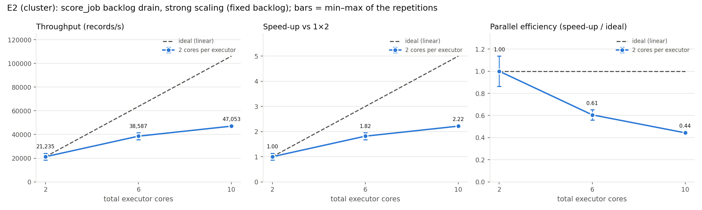

# E2 (cluster): scaling of the stream scoring job (backlog drain)

Setup: for each config, `infra/cluster/drain_test.sh` recreates `telemetry.smd`, replays the backlog at max speed
with score_job **not** running, then starts score_job (`submit.sh -e E -c C`, `--reset`, trigger `0 seconds`,
`maxOffsetsPerTrigger = 200,000`) and times how long it takes to consume it; strong scaling: the same backlog of 2,000,000 records for every config, `replicate = 4` copies of every machine (112 keys).
Topic `telemetry.smd` recreated with **32 partitions**; `spark.sql.shuffle.partitions` = 2 × total cores (unless overridden). The per-config values of replicate, topic partitions and shuffle partitions are in the table.
**Experiment readonly:** score_job extra args `--read-only`.
2 repetitions per config (interleaved), mean with min–max in brackets.
Cluster: Azure India South Central, 2 subscriptions joined by VNet peering: spark-master D2as_v4 (Kafka, NFS, driver); 5 workers (3 D2as_v4, 2 E2as_v4), 2 vCPU + 4 GB Spark each. Measured 2026-11-17 with
`python experiments/e2_scaling_sweep.py --configs 1x2 3x2 5x2 --repeats 2 --tag readonly --job-args=--read-only --cluster Azure India South Central, 2 subscriptions joined by VNet peering: spark-master D2as_v4 (Kafka, NFS, driver); 5 workers (3 D2as_v4, 2 E2as_v4), 2 vCPU + 4 GB Spark each`.

- **drain time**: start of the first micro-batch with input rows → end of the last one (job start-up excluded);
  **records/s** = backlog / drain time; **steady records/s** = the same without the first batch (it pays the
  Python workers' torch import and model load).
- **speed-up** = records/s / records/s of 1 × 2;
  **ideal** = total cores / 2; **efficiency** = speed-up / ideal.
- **batches**, **batch mean / p95**: micro-batches with input rows and their `triggerExecution` durations;
  **executors seen**: distinct executor ids in the driver's Spark UI during the run.

| executors × cores | total cores | replicate | topic partitions | shuffle partitions | runs drained | drain time (s) | records/s | steady records/s | speed-up | ideal | efficiency | batches | batch mean (s) | batch p95 (s) | executors seen |
| --- | ---: | ---: | ---: | ---: | ---: | ---: | ---: | ---: | ---: | ---: | ---: | ---: | ---: | ---: | ---: |
| 1 × 2 | 2 | 4 | 32 | 4 | 2/2 | 96.0 (82.9–109.1) | 21,235 (18,339–24,130) | 28,618 (27,634–29,601) | 1.00 (0.86–1.14) | 1.00 | 1.00 (0.86–1.14) | 11 | 8.72 | 33.00 | 1 |
| 3 × 2 | 6 | 4 | 32 | 12 | 2/2 | 52.1 (48.2–56.1) | 38,587 (35,664–41,511) | 52,273 (45,858–58,688) | 1.82 (1.68–1.95) | 3.00 | 0.61 (0.56–0.65) | 11 | 4.74 | 17.17 | 3 |
| 5 × 2 | 10 | 4 | 32 | 20 | 2/2 | 42.5 (42.3–42.7) | 47,053 (46,820–47,286) | 63,433 (63,254–63,611) | 2.22 (2.20–2.23) | 5.00 | 0.44 (0.44–0.45) | 11 | 3.86 | 14.13 | 5 |

Highest throughput: 5 × 2 (10 cores), 47,053 records/s, 2.22× the base config. At 10 cores the parallel efficiency is 0.44.

## Every run

| run | status | replicate | topic partitions | shuffle partitions | records | drain (s) | records/s | batches | batch mean (s) | batch p95 (s) | executors seen |
| --- | --- | ---: | ---: | ---: | ---: | ---: | ---: | ---: | ---: | ---: | ---: |
| e2_readonly_20261117T145121Z_e1c2_rep1 | drained | 4 | 32 | 4 | 2,000,000 | 109.1 | 18,339 | 11 | 9.91 | 43.92 | 1 |
| e2_readonly_20261117T145121Z_e3c2_rep1 | drained | 4 | 32 | 12 | 2,000,000 | 48.2 | 41,511 | 11 | 4.38 | 17.51 | 3 |
| e2_readonly_20261117T145121Z_e5c2_rep1 | drained | 4 | 32 | 20 | 2,000,000 | 42.7 | 46,820 | 11 | 3.88 | 14.42 | 5 |
| e2_readonly_20261117T145121Z_e1c2_rep2 | drained | 4 | 32 | 4 | 2,000,000 | 82.9 | 24,130 | 11 | 7.53 | 22.08 | 1 |
| e2_readonly_20261117T145121Z_e3c2_rep2 | drained | 4 | 32 | 12 | 2,000,000 | 56.1 | 35,664 | 11 | 5.10 | 16.83 | 3 |
| e2_readonly_20261117T145121Z_e5c2_rep2 | drained | 4 | 32 | 20 | 2,000,000 | 42.3 | 47,286 | 11 | 3.84 | 13.84 | 5 |
