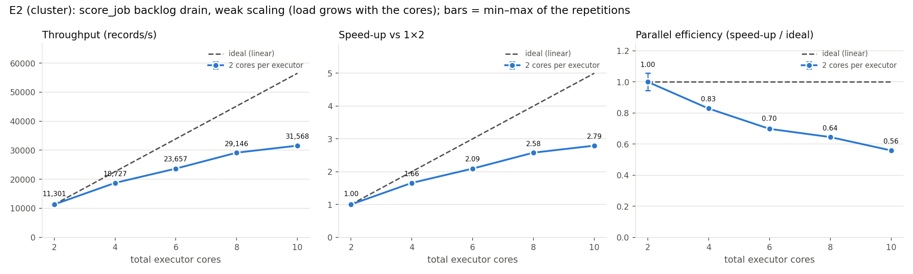

# E2 (cluster): scaling of the stream scoring job (backlog drain)

Setup: for each config, `infra/cluster/drain_test.sh` recreates `telemetry.smd`, replays the backlog at max speed
with score_job **not** running, then starts score_job (`submit.sh -e E -c C`, `--reset`, trigger `0 seconds`,
`maxOffsetsPerTrigger = 200,000`) and times how long it takes to consume it; weak scaling: config with T total cores replays `replicate = T / 2` copies of every machine and a backlog of 1,000,000 × replicate records.
Topic `telemetry.smd` recreated with **32 partitions**; `spark.sql.shuffle.partitions` = 2 × total cores (unless overridden). The per-config values of replicate, topic partitions and shuffle partitions are in the table.
2 repetitions per config (interleaved), mean with min–max in brackets.
Cluster: Azure India South Central, 2 subscriptions joined by VNet peering: spark-master D2as_v4 (Kafka, NFS, driver); 5 workers (3 D2as_v4, 2 E2as_v4), 2 vCPU + 4 GB Spark each. Measured 2026-11-15 with
`python experiments/e2_scaling_sweep.py --weak --configs 1x2 2x2 3x2 4x2 5x2 --repeats 2 --records 1000000 --cluster Azure India South Central, 2 subscriptions joined by VNet peering: spark-master D2as_v4 (Kafka, NFS, driver); 5 workers (3 D2as_v4, 2 E2as_v4), 2 vCPU + 4 GB Spark each`.

- **drain time**: start of the first micro-batch with input rows → end of the last one (job start-up excluded);
  **records/s** = backlog / drain time; **steady records/s** = the same without the first batch (it pays the
  Python workers' torch import and model load).
- **speed-up** = records/s / records/s of 1 × 2;
  **ideal** = total cores / 2; **efficiency** = speed-up / ideal.
- **batches**, **batch mean / p95**: micro-batches with input rows and their `triggerExecution` durations;
  **executors seen**: distinct executor ids in the driver's Spark UI during the run.

| executors × cores | total cores | replicate | topic partitions | shuffle partitions | runs drained | drain time (s) | records/s | steady records/s | speed-up | ideal | efficiency | batches | batch mean (s) | batch p95 (s) | executors seen |
| --- | ---: | ---: | ---: | ---: | ---: | ---: | ---: | ---: | ---: | ---: | ---: | ---: | ---: | ---: | ---: |
| 1 × 2 | 2 | 1 | 32 | 4 | 2/2 | 88.8 (83.8–93.7) | 11,301 (10,675–11,927) | 15,445 (14,951–15,938) | 1.00 (0.94–1.06) | 1.00 | 1.00 (0.94–1.06) | 6 | 14.79 | 36.91 | 1 |
| 2 × 2 | 4 | 2 | 32 | 8 | 2/2 | 106.8 (106.3–107.3) | 18,727 (18,633–18,821) | 23,897 (23,875–23,919) | 1.66 (1.65–1.67) | 2.00 | 0.83 (0.82–0.83) | 11 | 9.71 | 31.48 | 2 |
| 3 × 2 | 6 | 3 | 32 | 12 | 2/2 | 126.8 (125.1–128.6) | 23,657 (23,329–23,986) | 28,817 (28,135–29,499) | 2.09 (2.06–2.12) | 3.00 | 0.70 (0.69–0.71) | 16 | 7.93 | 29.62 | 3 |
| 4 × 2 | 8 | 4 | 32 | 16 | 2/2 | 137.2 (136.6–137.8) | 29,146 (29,019–29,273) | 34,419 (34,228–34,609) | 2.58 (2.57–2.59) | 4.00 | 0.64 (0.64–0.65) | 21 | 6.53 | 8.44 | 4 |
| 5 × 2 | 10 | 5 | 32 | 20 | 2/2 | 158.4 (157.3–159.5) | 31,568 (31,345–31,791) | 36,459 (36,171–36,747) | 2.79 (2.77–2.81) | 5.00 | 0.56 (0.55–0.56) | 26 | 6.09 | 9.07 | 5 |

Highest throughput: 5 × 2 (10 cores), 31,568 records/s, 2.79× the base config. At 10 cores the parallel efficiency is 0.56.

## Every run

| run | status | replicate | topic partitions | shuffle partitions | records | drain (s) | records/s | batches | batch mean (s) | batch p95 (s) | executors seen |
| --- | --- | ---: | ---: | ---: | ---: | ---: | ---: | ---: | ---: | ---: | ---: |
| e2_20261115T151656Z_e1c2_rep1 | drained | 1 | 32 | 4 | 1,000,000 | 93.7 | 10,675 | 6 | 15.61 | 40.17 | 1 |
| e2_20261115T151656Z_e2c2_rep1 | drained | 2 | 32 | 8 | 2,000,000 | 107.3 | 18,633 | 11 | 9.75 | 32.08 | 2 |
| e2_20261115T151656Z_e3c2_rep1 | drained | 3 | 32 | 12 | 3,000,000 | 128.6 | 23,329 | 16 | 8.04 | 29.08 | 3 |
| e2_20261115T151656Z_e4c2_rep1 | drained | 4 | 32 | 16 | 4,000,000 | 136.6 | 29,273 | 21 | 6.51 | 8.12 | 4 |
| e2_20261115T151656Z_e5c2_rep1 | drained | 5 | 32 | 20 | 5,000,000 | 157.3 | 31,791 | 26 | 6.05 | 8.89 | 5 |
| e2_20261115T151656Z_e1c2_rep2 | drained | 1 | 32 | 4 | 1,000,000 | 83.8 | 11,927 | 6 | 13.97 | 33.65 | 1 |
| e2_20261115T151656Z_e2c2_rep2 | drained | 2 | 32 | 8 | 2,000,000 | 106.3 | 18,821 | 11 | 9.66 | 30.87 | 2 |
| e2_20261115T151656Z_e3c2_rep2 | drained | 3 | 32 | 12 | 3,000,000 | 125.1 | 23,986 | 16 | 7.81 | 30.16 | 3 |
| e2_20261115T151656Z_e4c2_rep2 | drained | 4 | 32 | 16 | 4,000,000 | 137.8 | 29,019 | 21 | 6.56 | 8.76 | 4 |
| e2_20261115T151656Z_e5c2_rep2 | drained | 5 | 32 | 20 | 5,000,000 | 159.5 | 31,345 | 26 | 6.13 | 9.24 | 5 |
