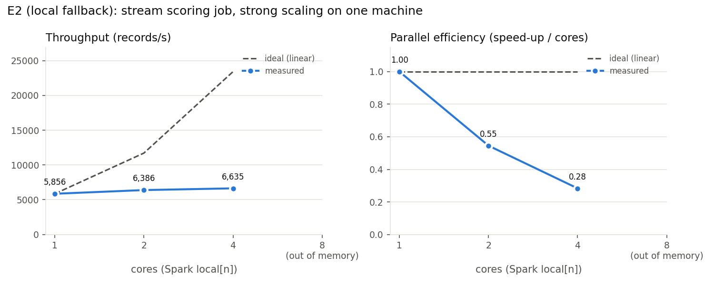

# E2 (local fallback): strong scaling of the stream scoring job

> **Fallback.** This is the single-machine version of E2, run in case the cloud VMs are late.
> The cluster version of E2 replaces it when the VMs are available.

## Before: 1 machine file per trigger (flat)

2 machines (104,346 records), `--files-per-trigger 1`,
1 run(s) per setting, measured 2026-11-01.

| cores | shuffle partitions | wall time (s) | batch time (s) | records/s | peak state rows | speed-up | efficiency |
| ---: | ---: | ---: | ---: | ---: | ---: | ---: | ---: |
| 1 | 2 | 177.0 | 130.9 | 797 | 2 | 1.00 | 1.00 |
| 2 | 4 | 186.8 | 143.0 | 730 | 2 | 0.92 | 0.46 |

Smoke test with the job's default `--files-per-trigger 1`. Each micro-batch held one machine, i.e. a single key of the `applyInPandasWithState` operator, so one task did all the scoring while the other cores sat idle; the second core only added scheduling overhead. The runs below therefore put 8 machines in each micro-batch.

## Before the thread fix: 8 files per trigger, run 1 only

28 machines (1,416,825 records), `--files-per-trigger 8`,
1 run(s) per setting, measured 2026-11-01.

| cores | shuffle partitions | wall time (s) | batch time (s) | records/s | peak state rows | speed-up | efficiency |
| ---: | ---: | ---: | ---: | ---: | ---: | ---: | ---: |
| 1 | 2 | 268.0 | 225.6 | 6,280 | 28 | 1.00 | 1.00 |
| 2 | 4 | 292.7 | 258.9 | 5,472 | 28 | 0.87 | 0.44 |
| 4 | 8 | 336.9 | 307.3 | 4,611 | 28 | 0.73 | 0.18 |
| 8 | 16 | 479.8 | 444.2 | 3,190 | 28 | 0.51 | 0.06 |

In these runs only PyTorch was held to one thread per worker (`torch.set_num_threads(1)` in the model loader); the OpenMP, MKL and OpenBLAS thread pools that numpy and torch set up were still sized to the 12 hardware threads, so `local[n]` started n Python workers that could each spawn several math threads. As n grew these threads competed for the same 12 hardware threads and caches (oversubscription), while every worker also held its own copy of PyTorch and the models, so throughput *fell* from 6,280 records/s at 1 core to 3,190 at 8 (and the laptop was already short of memory, which made it worse). The main result below sets `OMP_NUM_THREADS`, `MKL_NUM_THREADS` and `OPENBLAS_NUM_THREADS` to 1 before the SparkSession starts, so every local-mode worker inherits one math thread.

## Main result

Setup: `python src/streaming/score_job.py --input files --once --reset --files-per-trigger 8`
on all 28 SMD machines (1,416,825 records, 4 micro-batches),
Spark master `local[n]`, `spark.sql.shuffle.partitions = 2n`, one math thread per Python worker,
2 runs per setting, median of the completed runs. Machine: Windows, Intel64 Family 6 Model 186 Stepping 2, GenuineIntel
(12 logical cores, 15.6 GB RAM). Measured 2026-11-01 with
`python experiments/e2_local_scaling.py`; a run is stopped and counted as out of memory if free RAM drops below
1 GB.

- **wall time**: whole process (JVM start, all micro-batches, shutdown);
  **batch time**: sum of micro-batch durations;
  **records/s** = records / batch time; **peak state rows** = largest state store size (one row per machine).
- **speed-up** = records/s at n cores / records/s at 1 core; **efficiency** = speed-up / n.
- **peak memory**: peak total RSS of the job's processes (driver Python, JVM, Python workers), sampled every
  second; **free RAM before**: available RAM when the run started.

| cores | shuffle partitions | wall time (s) | batch time (s) | records/s | peak state rows | speed-up | efficiency | peak memory (GB) | free RAM before (GB) | runs completed |
| ---: | ---: | ---: | ---: | ---: | ---: | ---: | ---: | ---: | ---: | ---: |
| 1 | 2 | 279.6 | 251.7 | 5,856 | 28 | 1.00 | 1.00 | 1.53 | 3.7 | 2/2 |
| 2 | 4 | 273.4 | 244.7 | 6,386 | 28 | 1.09 | 0.55 | 1.99 | 4.6 | 2/2 |
| 4 | 8 | 250.7 | 221.2 | 6,635 | 28 | 1.13 | 0.28 | 2.60 | 5.0 | 2/2 |
| 8 | 16 | – | – | out of memory | – | – | – | 3.85 | 4.6 | 0/1 (1 out of memory) |

**Where scaling flattens and why.** With the thread fix, throughput no longer falls as cores are added,
but it barely rises either: about 1.1x at 2 cores and 1.13x at 4 (efficiency 0.55 and 0.28), and at 8 cores
the run was stopped for memory before its first micro-batch finished. Three things cap it:
(1) **shuffle and keys.** Each micro-batch holds only 8 machines, i.e. 8 keys, hashed into 2n shuffle partitions, so
at most 8 tasks have work, some partitions get 2–3 machines while others get none, and the batch waits for
the busiest one, while every extra partition adds a state-store checkpoint per batch;
(2) **Python worker overhead.** Every core runs its own Python worker that loads PyTorch and the models (about
0.3–0.4 GB each: peak memory grows from 1.5 GB at 1 core to 2.6 GB at 4, and reached 3.85 GB at 8 before the stop), and every row
crosses the JVM↔Python Arrow boundary, which costs the same at any core count;
(3) **single-disk I/O.** Reading the raw Parquet, the state checkpoints and the score files all go to one laptop
SSD, which more cores cannot speed up.

**Caveats.** Run-to-run noise on this laptop is as large as the effect being measured: the same 1-core
setting gave 4,702 and 7,010 records/s, mostly because free RAM was only 3–5 GB with other apps open. The first
micro-batch of each run also includes model loading and JVM warm-up. Read the speed-ups as "flat
within noise", not as precise values. The second 8-core run did not complete: the host stopped the whole
experiment for low memory during that run. The cluster version of E2, with one worker per VM and more memory
per worker, replaces these numbers.
