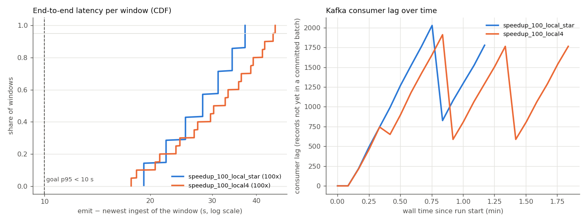

# End-to-end latency: Kafka -> score_job

## Final results (Linux, Azure spark-master)

Ubuntu 22.04, Standard_D2as_v4 (2 vCPU, 8 GB), single node, `local[2]`, 2 shuffle partitions, 5 s trigger,
Kafka 3.7 single broker in Docker on the same VM. Full table and chart: [e2e_latency_linux.md](e2e_latency_linux.md).

| speed-up | records | windows | total p50 / p95 / max (s) | processing p95 (s) | peak lag (records) |
| --- | ---: | ---: | ---: | ---: | ---: |
| 100x | 56,000 | 11,116 | 11.5 / 13.5 / 14.9 | 3.5 | 448 |
| 500x | 280,000 | 55,916 | 5.6 / 7.9 / 11.1 | 2.3 | 2,268 |
| max | 400,000 | 79,932 | 7.8 / 18.2 / 23.9 | 10.4 | 71,641 |

At max speed, ≈1,740 records/s saturates the 2 CPUs: this is the single-node throughput limit and the
motivation for the E2 scaling experiment.

The processing p95 < 10 s target is met at 100x and 500x. Total latency adds the 5 s trigger and the
watermark wait (10 event-min = 6 s at 100x, 1.2 s at 500x), which is why 500x has the lower total.
Per-batch time is 2.1–2.4 s on Linux vs 15–19 s on the Windows laptop, confirming the worker-restart
finding below.

KMeans and PCA retrained on the VM reproduce E1 exactly (0.596 / 0.554, same flagged counts).

## Windows laptop (diagnostic, not final)

Measured on 2026-11-03 with `python experiments/e2e_latency_runs.py`, report by `python src/streaming/latency_report.py`.
Each run: `src/producer/replay.py --source smd --speedup S --limit N` and
`src/streaming/score_job.py --input kafka --reset` started together on an emptied `telemetry.smd` topic
(`OMP_NUM_THREADS=1`). Laptop: i5-13420H (12 threads), 16 GB RAM, Windows 11, Kafka 3.7.0 in Docker Desktop.

| run | speed-up | master | status | records in topic | windows | total p50 / p95 / max (s) | processing p50 / p95 / max (s) | batch run time p50 / max (s) | watermark wait p50 / p95 (s) | wait 11 min / speed-up (s) | peak lag (records) | p95 total < 10 s | p95 processing < 10 s |
| --- | --- | --- | --- | ---: | ---: | ---: | ---: | ---: | ---: | ---: | ---: | :---: | :---: |
| speedup_100_local_star | 100x | local[*] | out of memory | 3,204 | 196 | 28.2 / 37.2 / 37.2 | 12.6 / 12.6 / 12.6 | 12.6 / 12.6 | 15.6 / 24.6 | 6.60 | 2,028 | no | no |
| speedup_100_local4 | 100x | local[4] | out of memory | 5,052 | 560 | 31.4 / 44.7 / 45.3 | 11.3 / 11.7 / 11.7 | 11.4 / 12.0 | 20.1 / 33.6 | 6.60 | 1,911 | no | no |



## What the columns mean

* **total** = `emit_ts_ms − max_ingest_ts_ms`: from the moment the producer sent the *newest record of a
  window* to the moment the scored window was written (scores file and, for anomalies, the `anomalies` topic).
  This is what a user would call end-to-end latency, and it contains the watermark wait below.
* **processing** = `emit_ts_ms − batch_max_ingest_ts_ms`: from the newest record of that machine in the
  micro-batch that closed the window to the write: the time that record waited in Kafka for the next trigger
  (short while the producer is still sending, since Spark fixes a batch's offsets when it starts; up to one
  trigger interval when the producer stopped before the trigger) plus the micro-batch run time (Kafka read,
  parse, state update, AE + KMeans + PCA scoring, Parquet write, Kafka write) and any queueing behind a
  previous long batch.
* **batch run time** = `triggerExecution` of the micro-batches that had input rows.
* **watermark wait** = `batch_max_ingest_ts_ms − max_ingest_ts_ms` (measured): the 11 minutes of event time
  explained below converted to wall time, *plus* the time the closing records sat in Kafka until the next
  trigger fired (up to one trigger interval, 30 s by default). **11 min / speed-up** is the event-time part
  alone.
* **peak lag** = the largest number of records in `telemetry.smd` that no committed micro-batch had
  processed yet (broker end offsets minus the offsets of the newest committed batch in the checkpoint),
  sampled every 5 s.

## Why the 10-minute watermark is reported separately

A 5-minute window `[s, s+5)` cannot be scored when its last record (minute `s+4`) arrives: with a
10-minute watermark it is complete only once that machine has sent a record with event time `>= s+15`.
That is **11 minutes of event time** of pure waiting, by design (it lets out-of-order records join their
window). How long that is in wall-clock seconds depends only on how fast event time runs:

| replay speed-up | event-time wait in wall seconds (11 min / speed-up) |
| --- | ---: |
| 1x (real time) | 660 |
| 100x | 6.6 |
| 500x | 1.32 |
| max (0) | ≈ 0 (bounded by the producer rate) |

In production (speed-up 1) every window is therefore scored at the earliest 11 minutes after its newest
record, whatever the cluster does; this is a correctness choice, not a performance property. The
proposal's goal **p95 < 10 s** is about the stream, so it should be read against the **processing**
column; the **total** column shows the sum at each replay speed.

## Status of this measurement (2026-11-03): incomplete, both 100x attempts stopped by the RAM guard

The plan was three runs of up to 25 minutes each: speed-up 100 (`--limit 56000`), 500 (`--limit 280000`)
and 0 = max (`--limit 400000`). Only the **100x** run was attempted, twice, and both attempts were stopped
by the rule "stop if free RAM < 1 GB":

| attempt | score_job master | stopped at | free RAM before start | free RAM between batches | lowest free RAM |
| --- | --- | ---: | ---: | ---: | ---: |
| 1 | `local[*]` (12 Python workers) | 70 s | 3.75 GB | ≈ 1.8 GB | 0.83 GB |
| 2 | `local[4]` | 110 s | ≈ 3.7 GB | ≈ 1.8 GB | 0.81 GB |

Free RAM stayed close to 1.8 GB and then fell by about 1 GB once per micro-batch (every 30 s; see
`lag.csv` in each run folder). The 500x and max runs were **not** attempted. The numbers in the table above
come from 1 and 2 scored micro-batches only (196 and 560 windows). Treat them as a first look, not as the
result. The two investigations below explain both the per-batch cost and the RAM dips.

What the partial data shows:

* **Every micro-batch costs about 11 s, whatever it contains.** `addBatch` took 11.2 s for batch 0
  (**0 input rows**) and 10.5–11.1 s for 341–1,547 rows. As a result, **processing latency p95 is 11.7–12.6 s**,
  above the 10 s goal before any wait for the trigger.
* **Total latency is 28–45 s at 100x.** It is that ~11 s, plus up to 30 s waiting for the next trigger, plus
  the 6.6 s event-time wait of the 10-minute watermark.
* **Lag is a sawtooth.** It grows by 47 records/s × 30 s ≈ 1,400 records between commits and drops at each
  commit. The stream kept up with 100x.

## Investigation 1 (correctness): why the Kafka run flagged 30/30 test windows at the start

**Cause: `replay.py` sent `data/raw/source=smd/fake.parquet` along with the real data.** That file is
the 180-row test fixture from `tools/fake_data.py`. Its rows use the **real ids and timestamps**:
machine-1-1, machine-1-2 and machine-2-1, minutes 0–59, all `split = test`, label 0, every metric 0.15–0.27.
The batch jobs and `score_job --input files` skip it (`autoencoder.SKIP_FILES`), but `replay.load_raw()`
read every `*.parquet`. In Kafka, the first 12 windows of those 3 machines therefore mixed real *train*
rows with fake *test* rows:
- a window is `test` if any of its rows is test, so 36 train windows became test windows;
- their means are far from the machines' near-zero medians in robust-scale units, so `ae_score` reaches
  up to 3.1e6;
- all 36 were flagged.

3 × 12 = 36 is exactly the 36/36 of the smoke run and the 30 + 6 of the 100x run.

**Experiment.** I took the same 20,000 records (the first 20,000 in replay order, i.e. what
`replay.py --limit 20000` sends) and wrote them back per input file into `data/diag/subset_root`, with the
fake rows staying in `fake.parquet`. Each input was scored with the same `build_scores` query, models and
`--reset`, keeping every emitted window (train and test):
`python experiments/kafka_vs_files.py subset | files | kafka --tag before | kafka --tag after | compare A B`.

| | files | kafka, replay before fix | kafka, replay after fix |
| --- | ---: | ---: | ---: |
| records scored | 19,820 (fake.parquet skipped) | 20,000 | 19,820 |
| windows | 3,892 | 3,892 | 3,892 |
| test windows | 0 | 36 | 0 |
| is_anomaly, all windows | 24 (0.6%) | 60 (1.5%) | 24 (0.6%) |
| is_anomaly, train windows | 24 / 3,892 | 24 / 3,856 | 24 / 3,892 |
| is_anomaly, test windows | – | **36 / 36** | – |
| windows differing from files (ae_score > 1e-6, split or flag) | – | 36: machine-1-1, 1-2, 2-1, minutes 0–55 | **0** |
| max abs ae_score diff vs files | – | 3.1e6 | **0** |

The other explanations you suggested are ruled out:
- **History length (`adaptive` 288, `recenter` 24):** both inputs start with the same empty history, and
  every window outside the 36 has the same ae_score and flag in both. So a short history at stream start
  does not explain the difference. (It may still make early flags noisy, but the same way for both inputs.)
- **Event order across machines:** the state is per machine. Kafka (all 28 machines in one micro-batch,
  interleaved) and files (one machine per micro-batch) give identical windows once the fake rows are out.
- **Train windows missing in Kafka:** no. Both sides have the same 3,892 windows, train included.

**Fix (applied, small).** `replay.load_raw()` now skips `fake.parquet` when real files are present, the same
rule as the batch jobs. It still replays `fake.parquet` when that is the only file, so trying the pipeline
on fake data still works. There is a new test, `tests/test_replay.py::test_fake_parquet_skipped_next_to_real_files`.
After the fix, Kafka gives exactly the files answer (0 differing windows, max diff 0).

Side effect to keep in mind for old runs: in a contaminated stream the 3.1e6 scores stay in those 3 machines'
adaptive-threshold history (288 windows ≈ 24 h of event time), which could hide later anomalies on them. Any
Kafka-fed scores produced before this fix should be regenerated. The latency numbers are not affected: they
time every window regardless of its score.

## Investigation 2 (per-batch cost): Python workers are not reused on Windows. Confirmed.

Setup: `score_job --input kafka --reset --trigger "5 seconds" --master local[2] --shuffle-partitions 2`,
replay 1,200 records at 100x (`experiments/e2e_latency_runs.py --runs 100:1200 --trigger "5 seconds"
--master local[2] --shuffle-partitions 2 --replay-root data/diag/subset_root`). Each Python worker appended to
`$SCORE_JOB_WORKER_LOG` (new, off by default): pid, module import time and process age, `load_models` time,
and each `score_group` call. score_job now prints each batch's `durationMs` and the time of each
foreachBatch step.

A first attempt with replay reading the full raw layer was stopped by the RAM guard at 10 s (free RAM
2.7 GB → 0.46 GB). `replay.py` loads all 1.4M raw rows into memory even for `--limit 1200`. The
diagnosis runs therefore replay from the 20k subset folder.

Batch breakdown (second diagnosis run; the first gave the same picture):

| batch | input rows | triggerExecution | addBatch | count = stateful scoring | other foreachBatch steps |
| ---: | ---: | ---: | ---: | ---: | ---: |
| 0 | 0 | 19.1 s | 15.4 s | 11.8 s | 0.6 s |
| 1 | 682 | 18.8 s | 17.8 s | 16.3 s | 1.0 s |
| 2 | 518 | 15.6 s | 14.7 s | 13.9 s | 0.6 s |

Worker log: **every micro-batch got new Python processes.**

| batch | worker pids | process age when `import score_job` finished | import time | `load_models` | 14 × `score_group` |
| ---: | --- | ---: | ---: | ---: | ---: |
| 0 (0 rows) | 22208, 24216 | 7.7 s, 7.7 s | 6.1 s, 6.2 s | – (no rows) | – |
| 1 | 29032, 29076 | 7.4 s, 7.4 s | 5.9 s, 5.9 s | 0.91 s, 0.94 s | 2.2 s, 2.4 s |
| 2 | 9792, 3808 | 7.7 s, 8.0 s | 6.2 s, 6.5 s | 0.97 s, 0.96 s | 2.3 s, 2.4 s |

In the first diagnosis run: 2 batches with rows × 2 partitions = 4 tasks, 4 distinct pids, 4 `load_models`
calls. No pid appeared in two batches.

**Why.** From the bytecode of `PythonWorkerFactory` in `spark-core_2.12-3.5.1.jar`:
- `useDaemon = !System.getProperty("os.name").startsWith("Windows") && spark.python.use.daemon`;
- `releaseWorker()` returns a worker to the idle queue only when `useDaemon` is true. Otherwise it closes
  the socket and the worker exits.

On Windows, `spark.python.worker.reuse=true` (set in `build_spark`) therefore has no effect. Every task
of every micro-batch launches a fresh `python.exe`. It imports pyspark, numpy, pandas, pyarrow, torch and
score_job (about 6 s each when two start at once; 2.8 s + 2.0 s + 0.6 s for one process on an idle machine)
and loads the models again (about 0.9 s), only to do 2.3 s of real work.

This also explains the RAM dips: each worker is about 280 MB once torch and the models are loaded (measured),
and `local[4]` starts 4 new ones per batch, about 1.1 GB, matching the ~1 GB dip per batch.

**What it means for the goal.** On the Windows laptop, each micro-batch costs at least about 8.5 s of worker
startup before any scoring, and 14–19 s of `triggerExecution` was measured at `local[2]`. **Processing
p95 < 10 s cannot be reached on Windows with the current design**, whatever the trigger. On Linux (the cloud
VMs, or Spark inside a Linux container) the daemon forks workers and reuse works: after the first batch, a
batch should cost the scoring time plus Spark's own overhead. This has not been measured yet.

**Proposed fixes, not applied (each bigger than a one-liner):**
1. **Run the latency experiment on Linux** (cloud VMs, or a Spark container next to Kafka in Docker). It is
   the cheapest way to get a representative number and needs no code change. Recommended.
2. **Cut the per-worker startup on Windows.** The AE forward pass could run in numpy (export the dense AE
   weights once), so workers would never import torch. This changes the model files next to
   `model.pt`/`scaler.json`, which the contract freezes, so it needs Syam's approval and a new parity check.
3. **One shuffle partition per batch on the laptop** (`--shuffle-partitions 1`): one worker start per batch
   instead of two to four. It halves the RAM spike but not the latency, since workers start in parallel.
4. Lower `replay.py`'s memory: read only the rows needed for `--limit` instead of the whole raw layer.
   **Applied** (for the 8 GB VMs). Each sorted file is streamed in 256-row batches with buffered Parquet reads,
   and the files are k-way merged on (event_time, entity_id); `--limit` stops reading after N records. A
   file that is not sorted is loaded and sorted on its own. Measured on the SMD raw layer (sha256 over every
   key and value sent, fixed `ingest_ts`):

   | | records | identical output | wall time | peak RSS |
   | --- | ---: | :---: | ---: | ---: |
   | old, `--limit 20000` | 20,000 | – | 4 s | +2.2 GB |
   | new, `--limit 20000` | 20,000 | yes | 2 s | +0.24 GB |
   | old, all | 1,416,825 | – | 374 s | > 2.2 GB |
   | new, all | 1,416,825 | yes | 87 s | +0.25 GB |

## To repeat the runs

```
python experiments/e2e_latency_runs.py                                   # 100, 500, max; local[4]
python experiments/e2e_latency_runs.py --runs 100:56000 --trigger "5 seconds" --tag t5   # shorter trigger
python src/streaming/latency_report.py --notes docs/results/e2e_latency_notes.md
SCORE_JOB_WORKER_LOG=$PWD/data/diag/worker_log.jsonl python src/streaming/score_job.py ...   # worker log
```

