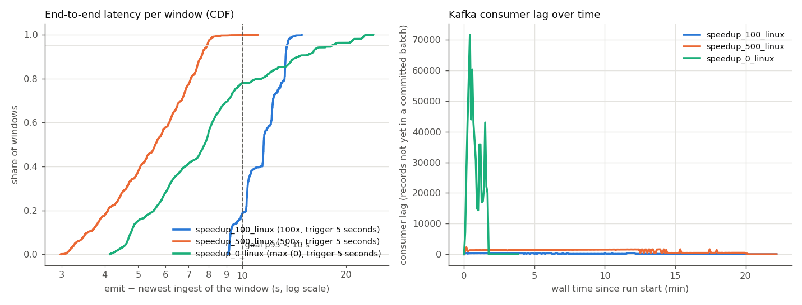

# End-to-end latency: Kafka -> score_job

Measured on 2026-11-04 with `python experiments/e2e_latency_runs.py`, report by `python src/streaming/latency_report.py`.
Each run: `src/producer/replay.py --source smd --speedup S --limit N` and
`src/streaming/score_job.py --input kafka --reset` started together on an emptied `telemetry.smd` topic
(`OMP_NUM_THREADS=1`). Azure Standard_D2as_v4 (2 vCPU, 8 GB), Ubuntu 22.04, Python 3.11.18, Spark 3.5.1 local[2], Kafka 3.7 single broker in Docker on the same VM.

| run | speed-up | master | status | records in topic | windows | total p50 / p95 / max (s) | processing p50 / p95 / max (s) | batch run time p50 / max (s) | watermark wait p50 / p95 (s) | wait 11 min / speed-up (s) | peak lag (records) | p95 total < 10 s | p95 processing < 10 s |
| --- | --- | --- | --- | ---: | ---: | ---: | ---: | ---: | ---: | ---: | ---: | :---: | :---: |
| speedup_100_linux | 100x, trigger 5 seconds | local[2] | ok | 56,000 | 11,116 | 11.5 / 13.5 / 14.9 | 2.6 / 3.5 / 4.3 | 2.4 / 5.1 | 9.0 / 10.8 | 6.60 | 448 | no | yes |
| speedup_500_linux | 500x, trigger 5 seconds | local[2] | ok | 280,000 | 55,916 | 5.6 / 7.9 / 11.1 | 1.8 / 2.3 / 6.6 | 1.8 / 6.0 | 3.7 / 5.9 | 1.32 | 2,268 | yes | yes |
| speedup_0_linux | max (0), trigger 5 seconds | local[2] | ok | 400,000 | 79,932 | 7.8 / 18.2 / 23.9 | 4.6 / 10.4 / 12.2 | 4.7 / 12.3 | 2.3 / 8.4 | 0.00 | 71,641 | no | no |

## What the columns mean

* **total** = `emit_ts_ms − max_ingest_ts_ms`: from the moment the producer sent the *newest record of a
  window* to the moment the scored window was written (scores file and, for anomalies, the `anomalies` topic).
  This is what a user would call end-to-end latency, and it contains the watermark wait below.
* **processing** = `emit_ts_ms − batch_max_ingest_ts_ms`: from the newest record of that machine in the
  micro-batch that closed the window to the write: the time that record waited in Kafka for the next trigger
  (short while the producer is still sending, since Spark fixes a batch's offsets when it starts; up to one
  trigger interval when the producer stopped before the trigger) plus the micro-batch run time (Kafka read,
  parse, state update, AE + KMeans + PCA scoring, Parquet write, Kafka write) and any queueing behind a
  previous long batch.
* **batch run time** = `triggerExecution` of the micro-batches that had input rows.
* **watermark wait** = `batch_max_ingest_ts_ms − max_ingest_ts_ms` (measured): the 11 minutes of event time
  explained below converted to wall time, *plus* the time the closing records sat in Kafka until the next
  trigger fired (up to one trigger interval, 30 s by default). **11 min / speed-up** is the event-time part
  alone.
* **peak lag** = the largest number of records in `telemetry.smd` that no committed micro-batch had
  processed yet (broker end offsets minus the offsets of the newest committed batch in the checkpoint),
  sampled every 5 s.

## Why the 10-minute watermark is reported separately

A 5-minute window `[s, s+5)` cannot be scored when its last record (minute `s+4`) arrives: with a
10-minute watermark it is complete only once that machine has sent a record with event time `>= s+15`.
That is **11 minutes of event time** of pure waiting, by design (it lets out-of-order records join their
window). How long that is in wall-clock seconds depends only on how fast event time runs:

| replay speed-up | event-time wait in wall seconds (11 min / speed-up) |
| --- | ---: |
| 1x (real time) | 660 |
| 100x | 6.6 |
| 500x | 1.32 |
| max (0) | ≈ 0 (bounded by the producer rate) |

In production (speed-up 1) every window is therefore scored at the earliest 11 minutes after its newest
record, whatever the cluster does; this is a correctness choice, not a performance property. The
proposal's goal **p95 < 10 s** is about the stream, so it should be read against the **processing**
column; the **total** column shows the sum at each replay speed.

