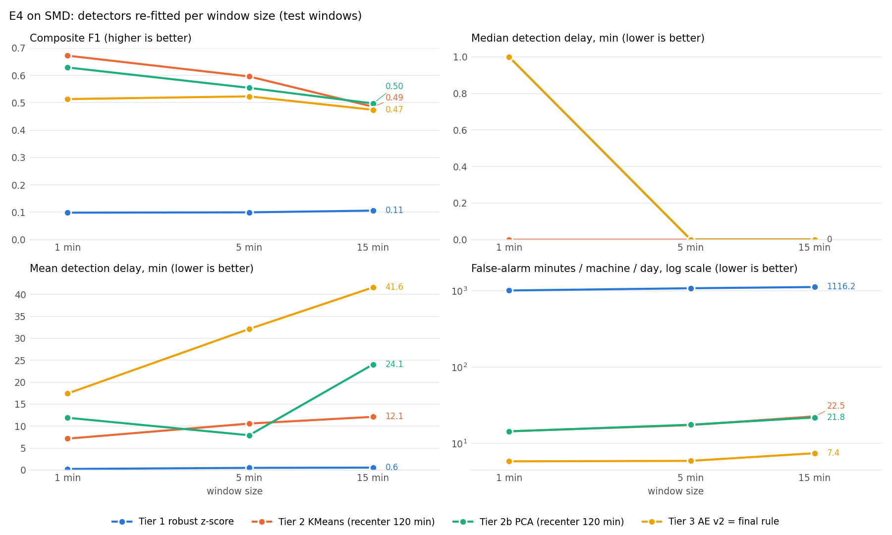

# E4: window size study on SMD

Scores and models from `python experiments/e4_windows.py` on all SMD machines; this report was rebuilt from the saved scores under `data/e4/w<N>/` with `python experiments/e4_windows.py --report-only` (nothing re-trained).

## Method

For each window size w in {1, 5, 15} minutes the SMD windows are rebuilt from
`data/raw/source=smd` (tumbling, epoch-aligned, per machine; a window is `test` if any of its rows is a test row and
its label is 1 if any row is labelled anomalous) and every detector is re-fitted on train windows only and scored on
test windows, with the existing functions in `src/detection/` (window size passed as a parameter, default 5 minutes):
Tier 1 robust z-score v1 (train median/MAD per machine-metric, MAD 0 skipped, flag if z > 3);
Tier 2 KMeans (k in 3..10 by silhouette, re-chosen per w); Tier 2b PCA (fewest components for 90% of the train
variance, re-chosen per w); Tier 3 AE v2 (mean and max inputs, seed 42, early stopping). KMeans, PCA and AE v2 centre
each test window on the median of the machine's previous 120 minutes of windows (120 / w windows; 24 at 5 min);
AE v2 also requires its score to exceed the 99th percentile of the machine's previous day of scores (1440 / w
windows; 288 at 5 min). Thresholds: 99.5th percentile of the train score x 1.1, over all machines, fitted per w.
**Final rule** `is_anomaly = ae_flag` (contract rev C). **Metrics**: the `evaluate` function of
`src/detection/autoencoder.py` that `e1_report.py` uses, with w-minute windows (definitions in `docs/results/e1.md`);
mean delay averages the same per-fault delays as the median. *Caught of 5-min faults* counts the faults defined on
5-minute windows that overlap at least one flagged window, so every row has the same denominator.

## Settings per window size

| window | machines | train windows | test windows | recenter (windows) | adaptive (windows) | KMeans k | PCA components | AE epochs (best) | run time (min) |
| ---: | ---: | ---: | ---: | ---: | ---: | ---: | ---: | ---: | ---: |
| 1 min | 28 | 708,405 | 708,420 | 120 | 1440 | 5 | 16 | 46 (41) | 15.2 |
| 5 min | 28 | 141,669 | 141,708 | 24 | 288 | 4 | 16 | 50 (47) | 4.7 |
| 15 min | 28 | 47,216 | 47,254 | 8 | 96 | 3 | 15 | 50 (50) | 2.4 |

## Results (test windows)

| window | detector | composite F1 | faults caught | caught of 5-min faults | alarm precision | false alarms / machine / day | false-alarm minutes / machine / day | median delay (min) | mean delay (min) | PR-AUC | windows flagged |
| ---: | --- | ---: | ---: | ---: | ---: | ---: | ---: | ---: | ---: | ---: | ---: |
| 1 min | Tier 1 robust z-score | 0.098 | 322/327 | 324/326 | 0.052 | 1005.90 | 1005.9 | 0 | 0.3 | 0.117 | 521,818 / 708,420 |
| 1 min | Tier 2 KMeans (recenter 120 min) | 0.672 | 298/327 | 297/326 | 0.532 | 14.36 | 14.4 | 0 | 7.2 | 0.313 | 15,094 / 708,420 |
| 1 min | Tier 2b PCA (recenter 120 min) | 0.629 | 251/327 | 251/326 | 0.532 | 14.32 | 14.3 | 1 | 11.9 | 0.309 | 15,065 / 708,420 |
| 1 min | Tier 3 AE v2 | 0.513 | 215/327 | 215/326 | 0.421 | 5.80 | 5.8 | 1 | 17.4 | 0.305 | 4,926 / 708,420 |
| 1 min | Final rule: is_anomaly = ae_flag | 0.513 | 215/327 | 215/326 | 0.421 | 5.80 | 5.8 | 1 | 17.4 | 0.305 | 4,926 / 708,420 |
| 5 min | Tier 1 robust z-score | 0.099 | 323/326 | 323/326 | 0.052 | 215.14 | 1075.7 | 0 | 0.5 | 0.136 | 111,702 / 141,708 |
| 5 min | Tier 2 KMeans (recenter 120 min) | 0.596 | 215/326 | 215/326 | 0.543 | 3.46 | 17.3 | 0 | 10.6 | 0.353 | 3,732 / 141,708 |
| 5 min | Tier 2b PCA (recenter 120 min) | 0.554 | 183/326 | 183/326 | 0.547 | 3.50 | 17.5 | 0 | 7.9 | 0.352 | 3,806 / 141,708 |
| 5 min | Tier 3 AE v2 | 0.523 | 179/326 | 179/326 | 0.500 | 1.18 | 5.9 | 0 | 32.1 | 0.355 | 1,157 / 141,708 |
| 5 min | Final rule: is_anomaly = ae_flag | 0.523 | 179/326 | 179/326 | 0.500 | 1.18 | 5.9 | 0 | 32.1 | 0.355 | 1,157 / 141,708 |
| 15 min | Tier 1 robust z-score | 0.106 | 324/326 | 324/326 | 0.056 | 74.41 | 1116.2 | 0 | 0.6 | 0.116 | 38,792 / 47,254 |
| 15 min | Tier 2 KMeans (recenter 120 min) | 0.485 | 151/326 | 151/326 | 0.510 | 1.50 | 22.5 | 0 | 12.1 | 0.363 | 1,507 / 47,254 |
| 15 min | Tier 2b PCA (recenter 120 min) | 0.497 | 154/326 | 154/326 | 0.525 | 1.45 | 21.8 | 0 | 24.1 | 0.358 | 1,504 / 47,254 |
| 15 min | Tier 3 AE v2 | 0.474 | 141/326 | 141/326 | 0.524 | 0.49 | 7.4 | 0 | 41.6 | 0.371 | 511 / 47,254 |
| 15 min | Final rule: is_anomaly = ae_flag | 0.474 | 141/326 | 141/326 | 0.524 | 0.49 | 7.4 | 0 | 41.6 | 0.371 | 511 / 47,254 |

**Comparing window sizes.** *False alarms / machine / day* and *alarm precision* count windows, not minutes: a 5-minute false episode is 5 false alarms at 1 min but 1 at 5 min. Across window sizes the *false-alarm minutes / machine / day* column (= false alarms per machine per day x window minutes) is the fair comparison; within one window size the minutes are the count times a constant, so they rank the detectors the same way. *Faults caught* uses each run's own faults (327 at 1 min, 326 at 5 min, 326 at 15 min); *caught of 5-min faults* (`caught_5min` in the console table) maps each run's detections onto the 326 faults defined on 5-minute windows, the E1 faults.



## Trade-off

Tier 3 AE v2: composite F1 0.513 at 1 min, 0.523 at 5 min, 0.474 at 15 min; false alarms per machine per day 5.80, 1.18, 0.49 (false-alarm minutes 5.8, 5.9, 7.4); mean delay 17.4, 32.1, 41.6 min. Going from 1 to 15 min the false-alarm count per day falls 11.7x, but false-alarm minutes rise 1.28x, so the larger window does not cut false-alarm time; the drop in the count comes from counting longer windows. Tier 2 KMeans (recenter 120 min): composite F1 0.672 at 1 min, 0.596 at 5 min, 0.485 at 15 min; false alarms per machine per day 14.36, 3.46, 1.50 (false-alarm minutes 14.4, 17.3, 22.5); mean delay 7.2, 10.6, 12.1 min. Going from 1 to 15 min the false-alarm count per day falls 9.6x, but false-alarm minutes rise 1.57x, so the larger window does not cut false-alarm time; the drop in the count comes from counting longer windows. Tier 2b PCA (recenter 120 min): composite F1 0.629 at 1 min, 0.554 at 5 min, 0.497 at 15 min; false alarms per machine per day 14.32, 3.50, 1.45 (false-alarm minutes 14.3, 17.5, 21.8); mean delay 11.9, 7.9, 24.1 min. Going from 1 to 15 min the false-alarm count per day falls 9.9x, but false-alarm minutes rise 1.52x, so the larger window does not cut false-alarm time; the drop in the count comes from counting longer windows. Tier 1 robust z-score: composite F1 0.098 at 1 min, 0.099 at 5 min, 0.106 at 15 min; false alarms per machine per day 1005.90, 215.14, 74.41 (false-alarm minutes 1005.9, 1075.7, 1116.2); mean delay 0.3, 0.5, 0.6 min. Going from 1 to 15 min the false-alarm count per day falls 13.5x, but false-alarm minutes rise 1.11x, so the larger window does not cut false-alarm time; the drop in the count comes from counting longer windows. Highest composite F1 per window size: 1 min Tier 2 KMeans (recenter 120 min) (0.672); 5 min Tier 2 KMeans (recenter 120 min) (0.596); 15 min Tier 2b PCA (recenter 120 min) (0.497). Delays are measured from the start of a fault's first window to the start of the first flagged window, so they do not include the time until a window closes and can be scored (up to w minutes); in the stream a 15-minute window can raise its alarm at the earliest 15 minutes after the fault begins, a 1-minute window after 1 minute. Faults are runs of anomalous windows, so their number changes with w (nearby faults merge at 15 minutes and can split at 1 minute); the "caught of 5-min faults" column keeps one denominator. False alarms per day and alarm precision count windows (see the note under the table), so across window sizes the false-alarm minutes column is the like-for-like comparison of false-alarm time; alarm precision, and composite F1 through it, still carry the window-counting effect, and a larger window is labelled anomalous if any of its minutes is, which also changes what counts as a correct alarm. These are results of one train/test split of one dataset (SMD) with one AE seed; differences of a few faults or a few hundredths of composite F1 are within what a retrain can change (E1 notes a 0.002 shift from retraining the AE on another laptop), so only larger gaps should be read as an effect of w.

## Check: 5-minute run against E1

**PASS** (full run: every detector row of e1.json, tolerance 0.001). Every compared value is within 0.001 of `docs/results/e1.json`.

## Reproduce

```
python experiments/e4_windows.py                 # re-fit and score every window size, then write the report
python experiments/e4_windows.py --report-only   # rebuild e4.md / e4.json / e4.png from data/e4/w<N>/ (no training)
```

Outputs: `data/e4/w<N>/scores/source=smd/scores.parquet` (scores-layer columns) and `models/e4/w<N>/`; the
production `data/scores*` and `models/*_smd` folders are not touched.
