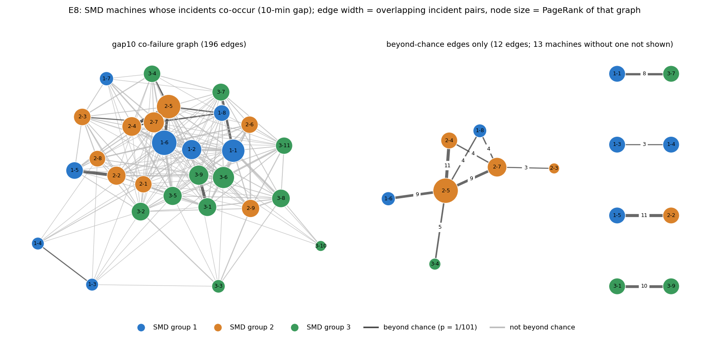

# E8: graph processing on incidents -- which SMD machines fail together?

Generated by `python experiments/e8_graph.py report` from `data/e8/pregel.json` (`experiments/e8_graph.py pregel`, Spark GraphFrames) and `data/e8/neo4j.json` (`experiments/e8_neo4j.py`, Neo4j + GDS). Pipeline defaults are unchanged.

## Summary

- **Machines do fail together more than chance.** With a 10-minute gap the graph has 196 edges and 419 co-occurring incident pairs; shuffling each machine's incident times gives 169 ± 9 edges and 282 ± 19 pairs (observed = 1.48 x chance, above all 100 shuffles). But most of the 196 edges are what chance alone would give between 28 machines; only 12 pairs are individually beyond chance, against 1.8 expected by luck.
- **Groups of machines that fail together** (components of the beyond-chance graph): {1-6, 1-8, 2-3, 2-4, 2-5, 2-7, 3-4}; {1-1, 3-7}; {1-3, 1-4}; {1-5, 2-2}; {3-1, 3-9}. The largest has 7 machines and spans SMD groups 1, 2, 3.
- **Pregel and Neo4j agree.** Connected components = GDS WCC on every graph: yes. Weighted PageRank, same formula: top-5 identical in order on every graph, largest difference 8.9e-16. Communities differ by algorithm more than by system: unweighted LPA finds 2 label(s) on gap10 (GraphFrames) vs 1 (GDS), weighted Louvain 5; on the beyond-chance graph Louvain returns exactly its connected components.
- **Co-failure groups do not follow the SMD machine groups.** Best ARI against the 1-x/2-x/3-x label is 0.08 (0 = chance); 6 of 12 beyond-chance edges join machines of the same SMD group (pair baseline 31%), a small excess at best.

## Input and graph

- Incidents: `data/e8/root/data/incidents/source=smd`, 623 incidents on 28 machines (incidents layer, `src/incidents/group.py`).
- Built for E8 because `data/incidents/source=smd` on this laptop held only the fake fixture: the AE batch test scores (`data/scores_ae/source=smd`, 28 machines, is_anomaly = ae_flag) were copied to a staging root and grouped there, leaving the pipeline layers untouched: `mkdir -p data/e8/root/data/scores/source=smd && cp data/scores_ae/source=smd/scores.parquet data/e8/root/data/scores/source=smd/ && python src/incidents/group.py --source smd --root data/e8/root`.
- One vertex per machine. Edge when two incidents of different machines co-occur: the later one starts at most G minutes after the earlier one ends. Weight = number of co-occurring incident pairs.
- `gap10`: G = 10 min (main; equals the incident session gap). `gap0`: intervals must truly overlap (sensitivity). `sig`: `gap10` edges whose weight is above all 100 shuffles (below).

| graph | edges | total weight | components (Pregel / GDS) |
| --- | ---: | ---: | --- |
| gap10 | 196 | 419 | 1 / 1 |
| gap0 | 103 | 148 | 1 / 1 |
| sig | 12 | 81 | 18 / 18 |

## Null check: edges expected by chance

Each machine's incident times were shuffled 100 times (seed 8): its incident durations and idle gaps are permuted inside its own time span, so the number of incidents, their lengths and the span are kept and only the alignment with other machines is destroyed.

| gap | observed edges | chance edges, mean ± sd (95th pct) | observed weight | chance weight, mean ± sd | p (edges / weight) | edges beyond chance | expected beyond chance by luck |
| --- | ---: | ---: | ---: | ---: | ---: | ---: | ---: |
| 10 min | 196 | 169.4 ± 9.1 (184) | 419 | 282.3 ± 19.4 | 0.010 / 0.010 | 12 | 1.8 |
| 0 (overlap) | 103 | 77.1 ± 7.6 (91) | 148 | 92.0 ± 9.8 | 0.010 / 0.010 | 7 | 1.4 |

## Pregel (GraphFrames) vs Neo4j (GDS)

| graph | same components? | PageRank top 5, Pregel | PageRank top 5, GDS | same top-5 set / order | Spearman | max abs diff | ARI LPA(GF) vs Louvain | ARI LPA(GF) vs LPA(GDS) |
| --- | --- | --- | --- | --- | ---: | ---: | ---: | ---: |
| gap10 | yes | 1-6, 2-5, 1-1, 3-6, 2-7 | 1-6, 2-5, 1-1, 3-6, 2-7 | yes / yes | 1.000 | 8.88e-16 | 0.01 | 0.00 |
| gap0 | yes | 1-6, 3-9, 2-5, 3-6, 2-7 | 1-6, 3-9, 2-5, 3-6, 2-7 | yes / yes | 1.000 | 6.66e-16 | 0.00 | 1.00 |
| sig | yes | 2-5, 2-7, 2-4, 1-1, 1-3 | 2-5, 2-7, 2-4, 1-1, 1-3 | yes / yes | 0.993 | 2.22e-16 | 0.59 | 0.59 |

Groups found (machine ids without `machine-`):

- **gap10** -- connected components: {1-1, 1-2, 1-3, 1-4, 1-5, 1-6, 1-7, 1-8, 2-1, 2-2, 2-3, 2-4, 2-5, 2-6, 2-7, 2-8, 2-9, 3-1, 3-10, 3-11, 3-2, 3-3, 3-4, 3-5, 3-6, 3-7, 3-8, 3-9}
  - LPA (GraphFrames): {1-1, 1-3, 1-4, 1-5, 1-6, 1-8, 2-1, 2-2, 2-3, 2-4, 2-5, 2-6, 2-7, 2-8, 2-9, 3-1, 3-11, 3-2, 3-3, 3-4, 3-5, 3-6, 3-7, 3-8, 3-9}; {1-2, 1-7, 3-10}
  - Louvain (GDS, modularity 0.240): {1-1, 1-2, 1-7, 2-1, 3-10, 3-7, 3-8}; {1-6, 1-8, 2-4, 2-5, 2-7, 3-4}; {2-6, 2-9, 3-1, 3-11, 3-6, 3-9}; {1-3, 1-4, 3-2, 3-3, 3-5}; {1-5, 2-2, 2-3, 2-8}
- **gap0** -- connected components: {1-1, 1-2, 1-3, 1-4, 1-5, 1-6, 1-7, 1-8, 2-1, 2-2, 2-3, 2-4, 2-5, 2-6, 2-7, 2-8, 2-9, 3-1, 3-10, 3-11, 3-2, 3-3, 3-4, 3-5, 3-6, 3-7, 3-8, 3-9}
  - LPA (GraphFrames): {1-1, 1-2, 1-3, 1-4, 1-5, 1-6, 1-7, 1-8, 2-1, 2-2, 2-3, 2-4, 2-5, 2-6, 2-7, 2-8, 2-9, 3-1, 3-10, 3-11, 3-2, 3-3, 3-4, 3-5, 3-6, 3-7, 3-8, 3-9}
  - Louvain (GDS, modularity 0.301): {1-1, 2-6, 2-9, 3-1, 3-11, 3-3, 3-6, 3-7, 3-8, 3-9}; {1-2, 1-3, 1-4, 1-5, 1-7, 2-2, 2-3, 2-8, 3-10, 3-2}; {1-6, 1-8, 2-1, 2-4, 2-5, 2-7, 3-4, 3-5}
- **sig** -- connected components: {1-6, 1-8, 2-3, 2-4, 2-5, 2-7, 3-4}; {1-1, 3-7}; {1-3, 1-4}; {1-5, 2-2}; {3-1, 3-9} + 13 singleton(s)
  - LPA (GraphFrames): {1-6, 1-8, 2-3, 2-4, 3-4}; {2-5, 2-7} + 21 singleton(s)
  - Louvain (GDS, modularity 0.589): {1-6, 1-8, 2-3, 2-4, 2-5, 2-7, 3-4}; {1-1, 3-7}; {1-3, 1-4}; {1-5, 2-2}; {3-1, 3-9} + 13 singleton(s)

## Do the groups follow the SMD machine groups (1-x, 2-x, 3-x)?

ARI = adjusted Rand index against the SMD group label (1 = identical partition, 0 = chance). Within-group share: fraction of edges joining two machines of the same SMD group, against the fraction of all machine pairs that are within one group.

| graph | ARI components | ARI LPA (GF) | ARI Louvain | ARI LPA (GDS) | within-group edges | within-group weight | within-group pairs (baseline) |
| --- | ---: | ---: | ---: | ---: | ---: | ---: | ---: |
| gap10 | 0.00 | 0.01 | 0.04 | 0.00 | 64/196 (33%) | 38% | 31% |
| gap0 | 0.00 | 0.00 | 0.08 | 0.00 | 36/103 (35%) | 36% | 31% |
| sig | 0.02 | -0.01 | 0.02 | 0.02 | 6/12 (50%) | 49% | 31% |

## Operator queries (Cypher, Neo4j)

**Q1. Which machines co-fail with machine-1-1 (gap10), strongest first?**

```cypher
MATCH (m:Machine {id: $machine})-[r:CO_FAIL_GAP10]-(o:Machine)
RETURN o.id AS machine, o.smd_group AS smd_group, r.weight AS overlapping_pairs,
       round(r.null_mean, 2) AS expected_by_chance, r.beyond_chance AS beyond_chance
ORDER BY overlapping_pairs DESC, machine
```

| machine | smd_group | overlapping_pairs | expected_by_chance | beyond_chance |
| --- | --- | --- | --- | --- |
| machine-3-7 | 3 | 8 | 1.730 | True |
| machine-1-2 | 1 | 7 | 2.200 | False |
| machine-3-8 | 3 | 7 | 1.800 | False |
| machine-1-6 | 1 | 5 | 1.940 | False |
| machine-2-5 | 2 | 3 | 1.350 | False |
| machine-2-9 | 2 | 3 | 1.520 | False |
| machine-3-6 | 3 | 3 | 1.810 | False |
| machine-2-4 | 2 | 2 | 0.480 | False |
| machine-2-6 | 2 | 2 | 1.000 | False |
| machine-3-11 | 3 | 2 | 1.480 | False |
| machine-1-5 | 1 | 1 | 0.590 | False |
| machine-1-8 | 1 | 1 | 0.560 | False |
| machine-2-1 | 2 | 1 | 1.000 | False |
| machine-2-2 | 2 | 1 | 0.940 | False |
| machine-2-7 | 2 | 1 | 0.580 | False |
| machine-3-1 | 3 | 1 | 0.800 | False |
| machine-3-10 | 3 | 1 | 0.350 | False |
| machine-3-2 | 3 | 1 | 0.810 | False |
| machine-3-5 | 3 | 1 | 2.220 | False |
| machine-3-9 | 3 | 1 | 1.230 | False |

**Q2. Largest co-failure group (connected component of the beyond-chance graph)**

```cypher
MATCH (m:Machine)
WITH m.sig_component AS component, collect(m.id) AS members
WHERE size(members) > 1
OPTIONAL MATCH (a:Machine)-[r:CO_FAIL_SIG]->(b:Machine)
WHERE a.sig_component = component AND b.sig_component = component
WITH component, members, count(r) AS edges, sum(r.weight) AS overlapping_pairs
RETURN size(members) AS size, members, edges, overlapping_pairs
ORDER BY size DESC, overlapping_pairs DESC
LIMIT 3
```

| size | members | edges | overlapping_pairs |
| --- | --- | --- | --- |
| 7 | machine-1-6, machine-1-8, machine-2-3, machine-2-4, machine-2-5, machine-2-7, machine-3-4 | 8 | 49 |
| 2 | machine-1-5, machine-2-2 | 1 | 11 |
| 2 | machine-3-1, machine-3-9 | 1 | 10 |

**Q3. Strongest beyond-chance pairs, and do they cross SMD groups?**

```cypher
MATCH (a:Machine)-[r:CO_FAIL_SIG]->(b:Machine)
RETURN a.id AS machine_a, b.id AS machine_b, r.weight AS overlapping_pairs,
       round(r.null_mean, 2) AS expected_by_chance, a.smd_group = b.smd_group AS same_smd_group
ORDER BY overlapping_pairs DESC, machine_a, machine_b
LIMIT 8
```

| machine_a | machine_b | overlapping_pairs | expected_by_chance | same_smd_group |
| --- | --- | --- | --- | --- |
| machine-1-5 | machine-2-2 | 11 | 0.740 | False |
| machine-2-4 | machine-2-5 | 11 | 0.440 | True |
| machine-3-1 | machine-3-9 | 10 | 0.440 | True |
| machine-1-6 | machine-2-5 | 9 | 2.030 | False |
| machine-2-5 | machine-2-7 | 9 | 0.640 | True |
| machine-1-1 | machine-3-7 | 8 | 1.730 | False |
| machine-2-5 | machine-3-4 | 5 | 0.890 | False |
| machine-1-8 | machine-2-5 | 4 | 0.410 | False |



## Runtime

- Pregel part (local[*], parallelism 12, Spark 3.5.1, `graphframes:graphframes:0.8.3-spark3.5-s_2.12`): total 210.9 s; graphs + 100-shuffle null model 5.1 s; Spark start 10.3 s; gap10 84.7 s; gap0 52.2 s; sig 38.7 s.
- Neo4j part (Neo4j 5.26.0 community, GDS 2.13.2): total 2.3 s (load 0.2 s, algorithms 2.0 s, queries 0.11 s).
- Spark self-join edges equal the pandas edges: {'gap10': True, 'gap0': True}.

Rerun the Pregel part on the Spark cluster (2 executors x 2 cores), on spark-master:

```bash
cd /srv/spark-shared/Anomaly-Detection && source .venv/bin/activate
# only if data/incidents/source=smd is missing there: python src/incidents/group.py --source smd
spark-submit --master spark://spark-master:7077 --executor-cores 2 --total-executor-cores 4 \
  --packages graphframes:graphframes:0.8.3-spark3.5-s_2.12 --repositories https://repos.spark-packages.org \
  --exclude-packages org.slf4j:slf4j-api \
  experiments/e8_graph.py pregel --incidents data/incidents/source=smd \
  --scores data/scores/source=smd --out-name pregel_cluster.json
```

## Caveats

- SMD has no real timestamps: row i of a machine is 2026-01-01 + i minutes (train rows first). Two machines' incidents line up only through this synthetic index, so 'at the same time' means 'at the same row offset'. Machines with longer training data start their test period later (9 machines start on 2026-01-20, the rest on 2026-01-17), which shifts their alignment. The null model keeps each machine's own span, so it controls for that, but a co-failure edge is still not proof of a shared physical cause.
- Incidents are AE alarms on the test split (is_anomaly = ae_flag), not ground-truth labels; false alarms are part of the graph.
- 378 machine pairs are tested; 'beyond chance' is an empirical p of 1/101 per pair with no further multiple-testing correction. The last column of the null table estimates how many such edges luck alone would produce.
- LPA (GraphFrames and GDS) is unweighted and its tie-breaking differs between the two systems; Louvain is weighted. Communities are therefore compared by ARI, not for identity; components and PageRank are deterministic and are compared exactly.
