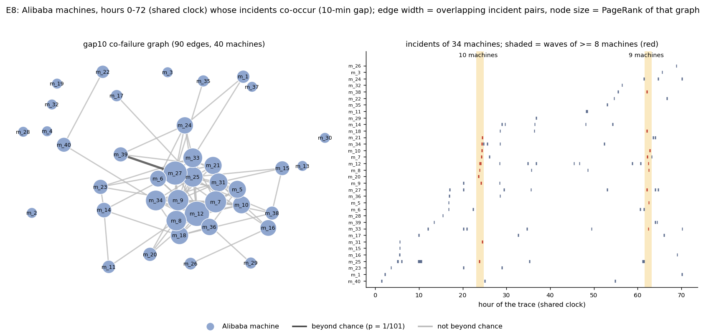
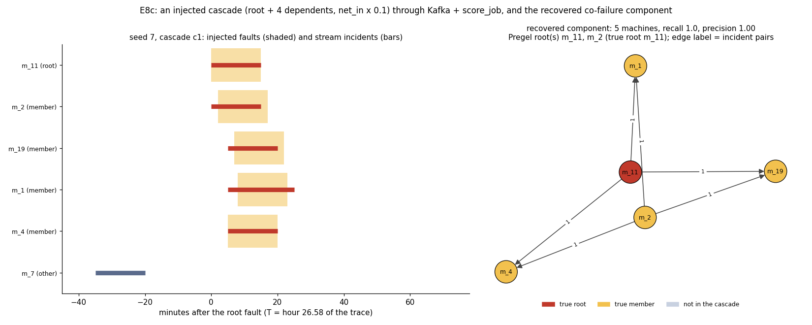

# E8: graph processing on incidents -- which machines fail together?

Generated by `python experiments/e8_graph.py report` from `data/e8/pregel[_alibaba].json` (`experiments/e8_graph.py pregel`, Spark GraphFrames) and `data/e8/neo4j[_alibaba].json` (`experiments/e8_neo4j.py`, Neo4j + GDS). Pipeline defaults are unchanged.

Two datasets with the same method. **SMD** (part 1) has no timestamps: its 'times' are row offsets (row i of a machine = 2026-01-01 + i minutes), so it is only a method check. **Alibaba v2018** (part 2) has one shared clock for all machines, so co-occurring incidents there really happened at the same time; it is the co-failure analysis.

## Summary

- **Alibaba (shared clock), the real analysis: co-failure comes as cluster-wide alarm waves.** 40 machines, 102 AE incidents in 3 days (hours 0-72, never seen in training). Machines alarm together far more than chance: 90 gap10 edges vs 46.8 ± 6.3 when each machine's incident times are shuffled (p = 0.010), and 39 truly overlapping pairs vs 12.4. The excess sits in 2 wave(s) of >= 8 machines (hour 23.5: 10 machines; hour 62.0: 9 machines), against 0.08 such waves by chance (p = 0.010); 4 machines are in every one of them (m_7, m_8, m_10, m_12; 2.2 expected if the waves drew their machines at random), the closest thing to a group that fails together on a real clock. Pairwise, only 1 machine pair is beyond chance (0.6 by luck): with 3.0 incidents per machine a pair co-occurs once or twice, which shuffles also produce, so the per-pair test has little power here and the wave test is the informative one. No labels: these are machines that alarm together, not confirmed faults.
- **SMD (synthetic row-offset time), the method check.** 196 edges vs 169 by chance, x1.48 the chance co-occurring pairs; 12 pairs beyond chance (1.8 by luck, 6% of the edges), groups {1-6, 1-8, 2-3, 2-4, 2-5, 2-7, 3-4}; {1-1, 3-7}; {1-3, 1-4}; {1-5, 2-2}; {3-1, 3-9}. SMD rows of different machines are not known to be simultaneous, so part 1 shows that the method works (both engines, the null check, the queries), not that SMD machines failed together.
- **SMD vs Alibaba.** Share of edges beyond chance: 6% (SMD) vs 1% (Alibaba); observed / chance edges x1.16 vs x1.92; machines in a pairwise co-failure group 15/28 vs 2/40 (largest 7 vs 2); largest alarm wave 10 vs 10 machines; waves of >= 5 machines 17 (chance 6.7) vs 3 (chance 1.2). SMD has many incidents per machine (dense graph, many testable pairs); Alibaba few per machine but sharp synchronized waves on a real clock.
- **Pregel (GraphFrames) and Neo4j (GDS) agree** on SMD and Alibaba v2018: connected components = WCC on every graph: yes; weighted PageRank top 5 in the same order: yes, largest difference 8.9e-16. Communities (LPA, Louvain) differ by algorithm, not by system.

## Method (both datasets)

- One vertex per machine. Edge when two incidents of different machines co-occur: the later one starts at most G minutes after the earlier one ends. Weight = number of co-occurring incident pairs.
- `gap10`: G = 10 min (main; equals the incident session gap). `gap0`: the intervals must truly overlap (sensitivity). `sig`: `gap10` edges whose weight is above all 100 shuffles.
- Null check: each machine's incident times are shuffled 100 times (seed 8): incident durations and idle gaps are permuted inside the machine's own time span, keeping its number of incidents, their lengths and the span, destroying only the alignment with other machines. 'Expected by luck' = leave-one-out count of pairs a shuffle would call beyond chance.
- Alarm waves: the incidents of all machines chained in time order with the same 10-minute gap; the number of waves with >= 3 / 5 / 8 machines and the largest wave are compared with the same shuffles.
- Pregel part: GraphFrames connectedComponents and labelPropagation, and weighted PageRank written with the GraphFrames Pregel API (GDS formula, d = 0.85, 30 iterations from 0). Neo4j part: the same CSV graph loaded with MERGE; GDS WCC, Louvain (weighted), LPA, PageRank (same formula); 3 operator queries.

## SMD vs Alibaba

| | SMD | Alibaba v2018 |
| --- | --- | --- |
| time base | synthetic: row i = T0 + i min, per machine | real, one clock for all |
| machines (with incidents) | 28 (28) | 40 (34) |
| observed span | 20.0 days | 3.0 days |
| incidents (per machine-day) | 623 (1.11) | 102 (0.85) |
| machine pairs | 378 | 780 |
| gap10 edges: observed / chance | 196 / 169.4 ± 9.1 | 90 / 46.8 ± 6.3 |
| co-occurring pairs: observed / chance | 419 / 282.3 (x1.48, p = 0.010) | 99 / 50.7 (x1.95, p = 0.010) |
| edges beyond chance (expected by luck) | 12 (1.8) | 1 (0.6) |
| share of edges beyond chance | 6% | 1% |
| share of machine pairs beyond chance | 3.2% | 0.1% |
| co-failure groups (sizes) | 5 (7, 2, 2, 2, 2) | 1 (2) |
| machines in a group | 15 of 28 | 2 of 40 |
| alarm waves with >= 3 machines: observed / chance (p) | 48 / 46.36 (p = 0.386) | 11 / 8.94 (p = 0.228) |
| alarm waves with >= 5 machines: observed / chance (p) | 17 / 6.74 (p = 0.010) | 3 / 1.21 (p = 0.099) |
| alarm waves with >= 8 machines: observed / chance (p) | 2 / 0.38 (p = 0.079) | 2 / 0.08 (p = 0.010) |
| largest alarm wave: machines / chance mean (p) | 10 / 7.0 (p = 0.040) | 10 / 5.4 (p = 0.020) |
| Pregel CC = GDS WCC (3 graphs) | yes | yes |
| PageRank top 5 same order (3 graphs) | yes | yes |
| PageRank max abs difference | 8.9e-16 | 8.9e-16 |
| Louvain on sig = its components | yes | yes |

## Part 1 -- SMD: method check (synthetic row-offset timestamps)

**SMD timestamps are synthetic.** The dataset has no clock; row i of each machine was given 2026-01-01T00:00Z + i minutes (train rows first, then test rows). Two machines' incidents 'co-occur' only in this row index; nothing says the rows were recorded at the same moment, and machines with longer training data start their test rows later (9 machines on 2026-01-20, the rest on 2026-01-17). Read part 1 as a test of the method on a labelled dataset, not as evidence that machines failed together.

### Input and graph

- Incidents: `data/e8/root/data/incidents/source=smd`, 623 incidents on 28 of 28 machines (scores: `data/scores_ae/source=smd`). Machines without an incident are isolated vertices.
- Built for E8 because `data/incidents/source=smd` on this laptop held only the fake fixture: the AE batch test scores (`data/scores_ae/source=smd`, is_anomaly = ae_flag) were copied to a staging root and grouped there: `mkdir -p data/e8/root/data/scores/source=smd && cp data/scores_ae/source=smd/scores.parquet data/e8/root/data/scores/source=smd/ && python src/incidents/group.py --source smd --root data/e8/root`.

| graph | edges | total weight | components (Pregel / GDS) |
| --- | ---: | ---: | --- |
| gap10 | 196 | 419 | 1 / 1 |
| gap0 | 103 | 148 | 1 / 1 |
| sig | 12 | 81 | 18 / 18 |

### Null check: edges expected by chance

| gap | observed edges | chance edges, mean ± sd (95th pct) | observed weight | chance weight, mean ± sd | p (edges / weight) | edges beyond chance | expected beyond chance by luck |
| --- | ---: | ---: | ---: | ---: | ---: | ---: | ---: |
| 10 min | 196 | 169.4 ± 9.1 (184) | 419 | 282.3 ± 19.4 | 0.010 / 0.010 | 12 | 1.8 |
| 0 (overlap) | 103 | 77.1 ± 7.6 (91) | 148 | 92.0 ± 9.8 | 0.010 / 0.010 | 7 | 1.4 |

### Alarm waves (incident level)

Incidents of all machines chained in time order with the same 10-minute gap; a wave is a chain. Same 100 shuffles as above.

| waves with >= k machines | observed | incidents in them | chance, mean ± sd | p |
| --- | ---: | ---: | ---: | ---: |
| k = 3 | 48 | 250 | 46.36 ± 4.65 | 0.386 |
| k = 5 | 17 | 134 | 6.74 ± 2.27 | 0.010 |
| k = 8 | 2 | 27 | 0.38 ± 0.62 | 0.079 |
| largest wave (machines) | 10 | | 7.0 (max 10) | 0.040 |

Largest waves (342 waves in all, 114 with 2+ machines):

| start (row offset in hours, synthetic) | minutes | machines | incidents | members |
| ---: | ---: | ---: | ---: | --- |
| 704.67 | 120 | 10 | 15 | 1-1, 1-2, 1-6, 1-8, 2-4, 2-5, 2-7, 3-1, 3-4, 3-9 |
| 642.25 | 110 | 8 | 12 | 1-3, 1-6, 2-4, 2-5, 2-7, 3-11, 3-5, 3-6 |
| 494.92 | 55 | 7 | 8 | 1-6, 2-3, 2-4, 2-5, 2-7, 3-4, 3-5 |
| 655.67 | 65 | 7 | 8 | 1-8, 3-1, 3-2, 3-5, 3-6, 3-7, 3-9 |
| 763.83 | 155 | 7 | 11 | 1-1, 2-4, 2-5, 3-10, 3-7, 3-8, 3-9 |
| 498.50 | 35 | 6 | 7 | 2-2, 2-6, 2-8, 3-1, 3-6, 3-9 |
| 597.33 | 70 | 6 | 6 | 1-6, 2-3, 2-5, 2-7, 2-8, 3-2 |
| 669.67 | 45 | 6 | 6 | 1-5, 1-6, 2-2, 2-4, 2-5, 3-7 |

### Pregel (GraphFrames) vs Neo4j (GDS)

| graph | same components? | PageRank top 5, Pregel | PageRank top 5, GDS | same top-5 set / order | Spearman | max abs diff | ARI LPA(GF) vs Louvain | ARI LPA(GF) vs LPA(GDS) |
| --- | --- | --- | --- | --- | ---: | ---: | ---: | ---: |
| gap10 | yes | 1-6, 2-5, 1-1, 3-6, 2-7 | 1-6, 2-5, 1-1, 3-6, 2-7 | yes / yes | 1.000 | 8.88e-16 | 0.01 | 0.00 |
| gap0 | yes | 1-6, 3-9, 2-5, 3-6, 2-7 | 1-6, 3-9, 2-5, 3-6, 2-7 | yes / yes | 1.000 | 6.66e-16 | 0.00 | 1.00 |
| sig | yes | 2-5, 2-7, 2-4, 1-1, 1-3 | 2-5, 2-7, 2-4, 1-1, 1-3 | yes / yes | 0.993 | 2.22e-16 | 0.59 | 0.59 |

Spearman below 1 with a difference near 1e-16 only reorders tied scores (isolated machines all have 1 - d = 0.15).

Groups found (machine ids without `machine-`):

- **gap10** -- connected components: {1-1, 1-2, 1-3, 1-4, 1-5, 1-6, 1-7, 1-8, 2-1, 2-2, 2-3, 2-4, 2-5, 2-6, 2-7, 2-8, 2-9, 3-1, 3-10, 3-11, 3-2, 3-3, 3-4, 3-5, 3-6, 3-7, 3-8, 3-9}
  - LPA (GraphFrames): {1-1, 1-3, 1-4, 1-5, 1-6, 1-8, 2-1, 2-2, 2-3, 2-4, 2-5, 2-6, 2-7, 2-8, 2-9, 3-1, 3-11, 3-2, 3-3, 3-4, 3-5, 3-6, 3-7, 3-8, 3-9}; {1-2, 1-7, 3-10}
  - Louvain (GDS, modularity 0.240): {1-1, 1-2, 1-7, 2-1, 3-10, 3-7, 3-8}; {1-6, 1-8, 2-4, 2-5, 2-7, 3-4}; {2-6, 2-9, 3-1, 3-11, 3-6, 3-9}; {1-3, 1-4, 3-2, 3-3, 3-5}; {1-5, 2-2, 2-3, 2-8}
- **gap0** -- connected components: {1-1, 1-2, 1-3, 1-4, 1-5, 1-6, 1-7, 1-8, 2-1, 2-2, 2-3, 2-4, 2-5, 2-6, 2-7, 2-8, 2-9, 3-1, 3-10, 3-11, 3-2, 3-3, 3-4, 3-5, 3-6, 3-7, 3-8, 3-9}
  - LPA (GraphFrames): {1-1, 1-2, 1-3, 1-4, 1-5, 1-6, 1-7, 1-8, 2-1, 2-2, 2-3, 2-4, 2-5, 2-6, 2-7, 2-8, 2-9, 3-1, 3-10, 3-11, 3-2, 3-3, 3-4, 3-5, 3-6, 3-7, 3-8, 3-9}
  - Louvain (GDS, modularity 0.301): {1-1, 2-6, 2-9, 3-1, 3-11, 3-3, 3-6, 3-7, 3-8, 3-9}; {1-2, 1-3, 1-4, 1-5, 1-7, 2-2, 2-3, 2-8, 3-10, 3-2}; {1-6, 1-8, 2-1, 2-4, 2-5, 2-7, 3-4, 3-5}
- **sig** -- connected components: {1-6, 1-8, 2-3, 2-4, 2-5, 2-7, 3-4}; {1-1, 3-7}; {1-3, 1-4}; {1-5, 2-2}; {3-1, 3-9} + 13 singleton(s)
  - LPA (GraphFrames): {1-6, 1-8, 2-3, 2-4, 3-4}; {2-5, 2-7} + 21 singleton(s)
  - Louvain (GDS, modularity 0.589): {1-6, 1-8, 2-3, 2-4, 2-5, 2-7, 3-4}; {1-1, 3-7}; {1-3, 1-4}; {1-5, 2-2}; {3-1, 3-9} + 13 singleton(s)

### Do the groups follow the SMD machine groups (1-x, 2-x, 3-x)?

ARI = adjusted Rand index against the SMD group label (1 = identical partition, 0 = chance). Within-group share: fraction of edges joining two machines of the same SMD group, against the fraction of all machine pairs that are within one group.

| graph | ARI components | ARI LPA (GF) | ARI Louvain | ARI LPA (GDS) | within-group edges | within-group weight | within-group pairs (baseline) |
| --- | ---: | ---: | ---: | ---: | ---: | ---: | ---: |
| gap10 | 0.00 | 0.01 | 0.04 | 0.00 | 64/196 (33%) | 38% | 31% |
| gap0 | 0.00 | 0.00 | 0.08 | 0.00 | 36/103 (35%) | 36% | 31% |
| sig | 0.02 | -0.01 | 0.02 | 0.02 | 6/12 (50%) | 49% | 31% |

### Operator queries (Cypher, Neo4j)

**Q1. Which machines co-fail with machine-1-1 (gap10), strongest first?**

```cypher
MATCH (m:Machine {id: $machine})-[r:CO_FAIL_GAP10]-(o:Machine)
RETURN o.id AS machine, o.group AS group, r.weight AS overlapping_pairs,
       round(r.null_mean, 2) AS expected_by_chance, r.beyond_chance AS beyond_chance
ORDER BY overlapping_pairs DESC, machine
LIMIT 15
```

| machine | group | overlapping_pairs | expected_by_chance | beyond_chance |
| --- | --- | --- | --- | --- |
| machine-3-7 | 3 | 8 | 1.730 | True |
| machine-1-2 | 1 | 7 | 2.200 | False |
| machine-3-8 | 3 | 7 | 1.800 | False |
| machine-1-6 | 1 | 5 | 1.940 | False |
| machine-2-5 | 2 | 3 | 1.350 | False |
| machine-2-9 | 2 | 3 | 1.520 | False |
| machine-3-6 | 3 | 3 | 1.810 | False |
| machine-2-4 | 2 | 2 | 0.480 | False |
| machine-2-6 | 2 | 2 | 1.000 | False |
| machine-3-11 | 3 | 2 | 1.480 | False |
| machine-1-5 | 1 | 1 | 0.590 | False |
| machine-1-8 | 1 | 1 | 0.560 | False |
| machine-2-1 | 2 | 1 | 1.000 | False |
| machine-2-2 | 2 | 1 | 0.940 | False |
| machine-2-7 | 2 | 1 | 0.580 | False |

**Q2. Largest co-failure groups (connected components of the beyond-chance graph)**

```cypher
MATCH (m:Machine)
WITH m.sig_component AS component, collect(m.id) AS members
WHERE size(members) > 1
OPTIONAL MATCH (a:Machine)-[r:CO_FAIL_SIG]->(b:Machine)
WHERE a.sig_component = component AND b.sig_component = component
WITH component, members, count(r) AS edges, sum(r.weight) AS overlapping_pairs
RETURN size(members) AS size, members, edges, overlapping_pairs
ORDER BY size DESC, overlapping_pairs DESC
LIMIT 3
```

| size | members | edges | overlapping_pairs |
| --- | --- | --- | --- |
| 7 | machine-1-6, machine-1-8, machine-2-3, machine-2-4, machine-2-5, machine-2-7, machine-3-4 | 8 | 49 |
| 2 | machine-1-5, machine-2-2 | 1 | 11 |
| 2 | machine-3-1, machine-3-9 | 1 | 10 |

**Q3. Strongest beyond-chance pairs, and do they cross SMD groups?**

```cypher
MATCH (a:Machine)-[r:CO_FAIL_SIG]->(b:Machine)
RETURN a.id AS machine_a, b.id AS machine_b, r.weight AS overlapping_pairs,
       round(r.null_mean, 2) AS expected_by_chance,
       a.group = b.group AS same_smd_group
ORDER BY overlapping_pairs DESC, machine_a, machine_b
LIMIT 8
```

| machine_a | machine_b | overlapping_pairs | expected_by_chance | same_smd_group |
| --- | --- | --- | --- | --- |
| machine-1-5 | machine-2-2 | 11 | 0.740 | False |
| machine-2-4 | machine-2-5 | 11 | 0.440 | True |
| machine-3-1 | machine-3-9 | 10 | 0.440 | True |
| machine-1-6 | machine-2-5 | 9 | 2.030 | False |
| machine-2-5 | machine-2-7 | 9 | 0.640 | True |
| machine-1-1 | machine-3-7 | 8 | 1.730 | False |
| machine-2-5 | machine-3-4 | 5 | 0.890 | False |
| machine-1-8 | machine-2-5 | 4 | 0.410 | False |


## Part 2 -- Alibaba v2018: co-failure on a shared clock

All 40 machines share the trace clock (2026-01-01T00:00Z = start of the trace), so incidents that co-occur here happened at the same time. **Alibaba has no labels:** an incident is a window run the AE flagged, so the groups below are machines that *alarm together*, not confirmed faults.

### Input and graph

- Incidents: `data/e8/alibaba_root/data/incidents/source=alibaba`, 102 incidents on 34 of 40 machines (scores: `data/e8/alibaba_root/data/scores/source=alibaba`). Machines without an incident are isolated vertices.
- Built by `python experiments/e8_alibaba_input.py`: the original trace (no injected faults) on hours 0-72, which `models/ae_alibaba` never saw (trained on hours 72-192, E5b), scored with `autoencoder.score_layer` (is_anomaly = ae_flag), grouped with `src/incidents/group.py --source alibaba --root data/e8/alibaba_root`. Pipeline layers untouched.

| graph | edges | total weight | components (Pregel / GDS) |
| --- | ---: | ---: | --- |
| gap10 | 90 | 99 | 10 / 10 |
| gap0 | 39 | 39 | 15 / 15 |
| sig | 1 | 2 | 39 / 39 |

### Null check: edges expected by chance

| gap | observed edges | chance edges, mean ± sd (95th pct) | observed weight | chance weight, mean ± sd | p (edges / weight) | edges beyond chance | expected beyond chance by luck |
| --- | ---: | ---: | ---: | ---: | ---: | ---: | ---: |
| 10 min | 90 | 46.8 ± 6.3 (57) | 99 | 50.7 ± 7.2 | 0.010 / 0.010 | 1 | 0.6 |
| 0 (overlap) | 39 | 12.4 ± 3.2 (18) | 39 | 12.7 ± 3.3 | 0.010 / 0.010 | 2 | 0.4 |

### Alarm waves (incident level)

Incidents of all machines chained in time order with the same 10-minute gap; a wave is a chain. Same 100 shuffles as above.

| waves with >= k machines | observed | incidents in them | chance, mean ± sd | p |
| --- | ---: | ---: | ---: | ---: |
| k = 3 | 11 | 52 | 8.94 ± 2.10 | 0.228 |
| k = 5 | 3 | 25 | 1.21 ± 0.98 | 0.099 |
| k = 8 | 2 | 20 | 0.08 ± 0.27 | 0.010 |
| largest wave (machines) | 10 | | 5.4 (max 10) | 0.020 |

Largest waves (48 waves in all, 24 with 2+ machines):

| start (hour of the trace) | minutes | machines | incidents | members |
| ---: | ---: | ---: | ---: | --- |
| 23.50 | 55 | 10 | 11 | m_10, m_12, m_20, m_21, m_25, m_31, m_34, m_7, m_8, m_9 |
| 62.00 | 50 | 9 | 9 | m_10, m_12, m_18, m_27, m_33, m_38, m_5, m_7, m_8 |
| 28.33 | 10 | 5 | 5 | m_12, m_18, m_34, m_36, m_9 |
| 4.92 | 40 | 4 | 4 | m_15, m_16, m_25, m_31 |
| 16.67 | 20 | 4 | 4 | m_27, m_36, m_5, m_6 |
| 20.08 | 5 | 4 | 4 | m_23, m_27, m_33, m_9 |
| 48.00 | 35 | 3 | 3 | m_11, m_14, m_8 |
| 61.00 | 35 | 3 | 3 | m_24, m_25, m_6 |

### Pregel (GraphFrames) vs Neo4j (GDS)

| graph | same components? | PageRank top 5, Pregel | PageRank top 5, GDS | same top-5 set / order | Spearman | max abs diff | ARI LPA(GF) vs Louvain | ARI LPA(GF) vs LPA(GDS) |
| --- | --- | --- | --- | --- | ---: | ---: | ---: | ---: |
| gap10 | yes | m_12, m_27, m_7, m_9, m_34 | m_12, m_27, m_7, m_9, m_34 | yes / yes | 1.000 | 8.88e-16 | 0.20 | 1.00 |
| gap0 | yes | m_27, m_34, m_24, m_21, m_12 | m_27, m_34, m_24, m_21, m_12 | yes / yes | 1.000 | 6.66e-16 | 0.54 | 0.75 |
| sig | yes | m_27, m_39, m_1, m_10, m_11 | m_27, m_39, m_1, m_10, m_11 | yes / yes | 1.000 | 1.11e-16 | 0.00 | 0.00 |

Spearman below 1 with a difference near 1e-16 only reorders tied scores (isolated machines all have 1 - d = 0.15).

Groups found:

- **gap10** -- connected components: {m_1, m_10, m_11, m_12, m_14, m_15, m_16, m_17, m_18, m_20, m_21, m_22, m_23, m_24, m_25, m_26, m_27, m_29, m_31, m_33, m_34, m_35, m_36, m_38, m_39, m_40, m_5, m_6, m_7, m_8, m_9} + 9 singleton(s)
  - LPA (GraphFrames): {m_1, m_10, m_11, m_12, m_14, m_15, m_16, m_17, m_18, m_20, m_21, m_22, m_23, m_24, m_25, m_26, m_27, m_29, m_31, m_33, m_34, m_35, m_36, m_38, m_39, m_40, m_5, m_6, m_7, m_8, m_9} + 9 singleton(s)
  - Louvain (GDS, modularity 0.250): {m_1, m_15, m_16, m_17, m_24, m_25, m_26, m_31, m_6}; {m_11, m_14, m_18, m_22, m_23, m_34, m_36, m_40, m_9}; {m_10, m_12, m_20, m_29, m_33, m_5, m_7, m_8}; {m_21, m_27, m_35, m_38, m_39} + 9 singleton(s)
- **gap0** -- connected components: {m_1, m_10, m_11, m_12, m_14, m_15, m_17, m_18, m_21, m_23, m_24, m_25, m_27, m_29, m_31, m_33, m_34, m_35, m_36, m_38, m_39, m_5, m_6, m_7, m_8, m_9} + 14 singleton(s)
  - LPA (GraphFrames): {m_10, m_15, m_18, m_21, m_27, m_31, m_34, m_35, m_36, m_38, m_39, m_7}; {m_1, m_12, m_17, m_23, m_6, m_8}; {m_11, m_24, m_25, m_5}; {m_14, m_29, m_33, m_9} + 14 singleton(s)
  - Louvain (GDS, modularity 0.497): {m_10, m_15, m_18, m_21, m_31, m_34, m_36, m_38, m_7}; {m_12, m_14, m_23, m_27, m_29, m_33, m_35, m_39, m_9}; {m_1, m_11, m_17, m_24, m_25, m_5, m_6, m_8} + 14 singleton(s)
- **sig** -- connected components: {m_27, m_39} + 38 singleton(s)
  - LPA (GraphFrames): none + 40 singleton(s)
  - Louvain (GDS, modularity 0.000): {m_27, m_39} + 38 singleton(s)

### Operator queries (Cypher, Neo4j)

**Q1. Which machines co-fail with m_27 (gap10), strongest first?**

```cypher
MATCH (m:AlibabaMachine {id: $machine})-[r:ALI_CO_FAIL_GAP10]-(o:AlibabaMachine)
RETURN o.id AS machine, o.group AS group, r.weight AS overlapping_pairs,
       round(r.null_mean, 2) AS expected_by_chance, r.beyond_chance AS beyond_chance
ORDER BY overlapping_pairs DESC, machine
LIMIT 15
```

| machine | group | overlapping_pairs | expected_by_chance | beyond_chance |
| --- | --- | --- | --- | --- |
| m_39 | - | 2 | 0.180 | True |
| m_14 | - | 1 | 0.320 | False |
| m_18 | - | 1 | 0.190 | False |
| m_21 | - | 1 | 0.250 | False |
| m_23 | - | 1 | 0.170 | False |
| m_24 | - | 1 | 0.180 | False |
| m_33 | - | 1 | 0.510 | False |
| m_35 | - | 1 | 0.070 | False |
| m_36 | - | 1 | 0.110 | False |
| m_38 | - | 1 | 0.120 | False |
| m_5 | - | 1 | 0.220 | False |
| m_6 | - | 1 | 0.170 | False |
| m_7 | - | 1 | 0.370 | False |
| m_8 | - | 1 | 0.270 | False |
| m_9 | - | 1 | 0.310 | False |

**Q2. Largest co-failure groups (connected components of the beyond-chance graph)**

```cypher
MATCH (m:AlibabaMachine)
WITH m.sig_component AS component, collect(m.id) AS members
WHERE size(members) > 1
OPTIONAL MATCH (a:AlibabaMachine)-[r:ALI_CO_FAIL_SIG]->(b:AlibabaMachine)
WHERE a.sig_component = component AND b.sig_component = component
WITH component, members, count(r) AS edges, sum(r.weight) AS overlapping_pairs
RETURN size(members) AS size, members, edges, overlapping_pairs
ORDER BY size DESC, overlapping_pairs DESC
LIMIT 3
```

| size | members | edges | overlapping_pairs |
| --- | --- | --- | --- |
| 2 | m_27, m_39 | 1 | 2 |

**Q3. Strongest beyond-chance pairs**

```cypher
MATCH (a:AlibabaMachine)-[r:ALI_CO_FAIL_SIG]->(b:AlibabaMachine)
RETURN a.id AS machine_a, b.id AS machine_b, r.weight AS overlapping_pairs,
       round(r.null_mean, 2) AS expected_by_chance
ORDER BY overlapping_pairs DESC, machine_a, machine_b
LIMIT 8
```

| machine_a | machine_b | overlapping_pairs | expected_by_chance |
| --- | --- | --- | --- |
| m_27 | m_39 | 2 | 0.180 |



## Runtime

- **SMD** Pregel part (local[*], parallelism 12, Spark 3.5.1, `graphframes:graphframes:0.8.3-spark3.5-s_2.12`): total 222.2 s (graphs + 100-shuffle null model 10.6 s; Spark start 5.5 s; gap10 85.6 s; gap0 54.2 s; sig 45.0 s). Neo4j part (Neo4j 5.26.0 community, GDS 2.13.2): total 2.3 s (load 0.4 s, algorithms 1.6 s, queries 0.38 s). Spark self-join edges = pandas edges: True.
- **Alibaba v2018** Pregel part (local[*], parallelism 12, Spark 3.5.1, `graphframes:graphframes:0.8.3-spark3.5-s_2.12`): total 197.7 s (graphs + 100-shuffle null model 1.7 s; Spark start 5.4 s; gap10 74.9 s; gap0 53.0 s; sig 42.3 s). Neo4j part (Neo4j 5.26.0 community, GDS 2.13.2): total 2.0 s (load 0.6 s, algorithms 1.1 s, queries 0.28 s). Spark self-join edges = pandas edges: True.
- Alibaba input (`experiments/e8_alibaba_input.py`): 58.8 s (raw slice 1.2 s, AE scoring 13.2 s, incidents 44.0 s); 26303 windows, 140 flagged.

Rerun the Pregel part on the Spark cluster (2 executors x 2 cores), on spark-master:

```bash
cd /srv/spark-shared/Anomaly-Detection && source .venv/bin/activate
# only if data/incidents/source=smd is missing there: python src/incidents/group.py --source smd
spark-submit --master spark://spark-master:7077 --executor-cores 2 --total-executor-cores 4 \
  --packages graphframes:graphframes:0.8.3-spark3.5-s_2.12 --repositories https://repos.spark-packages.org \
  --exclude-packages org.slf4j:slf4j-api \
  experiments/e8_graph.py pregel --source smd --incidents data/incidents/source=smd \
  --scores data/scores/source=smd --out-name pregel_cluster.json
```

```bash
cd /srv/spark-shared/Anomaly-Detection && source .venv/bin/activate
# builds the Alibaba incidents on the cluster first (needs PyTorch and models/ae_alibaba):
python experiments/e8_alibaba_input.py
spark-submit --master spark://spark-master:7077 --executor-cores 2 --total-executor-cores 4 \
  --packages graphframes:graphframes:0.8.3-spark3.5-s_2.12 --repositories https://repos.spark-packages.org \
  --exclude-packages org.slf4j:slf4j-api \
  experiments/e8_graph.py pregel --source alibaba --incidents data/e8/alibaba_root/data/incidents/source=alibaba \
  --scores data/e8/alibaba_root/data/scores/source=alibaba --out-name pregel_alibaba_cluster.json
```

## Caveats

- SMD: synthetic row-offset timestamps (part 1); the null model keeps each machine's own span, which controls for the two start dates, but an SMD edge is not evidence of a shared physical cause.
- Alibaba: no labels; incidents are AE alarms (is_anomaly = ae_flag) on 3 days, so a group means machines that alarm together. A shared alarm can also come from a cluster-wide event (deployment, batch job wave) that is normal for the operator.
- Incidents are AE alarms in both datasets; false alarms are part of the graph.
- The per-pair test needs several co-occurrences per pair: with ~3 incidents per Alibaba machine a pair co-occurs at most a few times, so few pairs can pass it even when the graph as a whole is far above chance. The alarm-wave test (count of waves with >= k machines) is the better test there.
- Each machine pair is tested at an empirical p of 1/101 with no further multiple-testing correction (378 SMD pairs, 780 Alibaba pairs). 'Expected by luck' estimates how many beyond-chance edges luck alone gives.
- LPA (GraphFrames and GDS) is unweighted and breaks ties differently in the two systems; Louvain is weighted. Communities are compared by ARI; components and PageRank are deterministic and compared exactly.

## E8c: injected cascades on Alibaba (stream detection, group and root recovery)

> **These are injected cascades**, not observed ones: a root fault and four dependent faults placed on random machines by `src/producer/inject_faults.py --mode cascade`. They test whether the pipeline and the graph method *can* recover a cascade of this shape; they say nothing about how often real Alibaba faults cascade, and real dependents need not start 2-8 minutes after their root.

**Result.** Over 3 seeds x 6 injected cascades, the stream detected 6.0 of 6 per seed (members alarmed 30.0 of 30). The machine graph recovered the group with member recall 1.00 and precision 0.26, and named the true root in 0.3 of 6 per seed (0.3 more in a tie); reverse PageRank put the root on top in 1.0. The time-resolved variant: recall 1.00, precision 0.85, root correct 0.7 of 6. False groups of >= 3 machines with injection: 0.0 per 24 h on the machine graph (background alarms are absorbed into the cascades' component and show up as the low precision instead) and 1.3 time-resolved; on the clean hours 0-72 0.3 and 3.0 per 24 h. Pregel = pandas reference on components and roots: True; Neo4j (GDS WCC, Cypher roots) = Pregel: True.

### Rules, fixed before any result was looked at

1. **Injection.** E5b slice (first 40 machines, hours 0-48), seeds 7, 8, 9. Per seed 6 cascades: one random root + 4 random dependents, root fault at T (5-minute aligned), each dependent at T + random 2-8 min, every fault 15 min of net_in x 0.1 (`break`, which the Alibaba AE catches reliably in E5b; `--cascade-type spike` exists but was not run). Cascades start and end in hours 24-47.5 (the last 30 min of the 24-48 h half are left out so the stream's 10-minute watermark closes every cascade window before the replay ends), at least 2 h apart, at least 1 h from the two clean-data alarm waves of E8 (hour 23.5 for 55 min, hour 62.0 for 50 min), on disjoint machines, never inside a gap of the trace (at least 5 machines with data over the whole cascade; added when the first planning attempt hit such a gap, before anything was scored). Ground truth: `data/e8/cascade_root/seed_<n>/inject/cascade_truth.json` (also in `e8_graph.json` under `cascade`).
2. **Stream.** The injected slice is replayed into Kafka `telemetry.alibaba` (`src/producer/replay.py --speedup 0`); `src/streaming/score_job.py --source alibaba --input kafka --once` reads exactly those records (starting offsets taken before the replay) and scores them with `models/ae_alibaba`, is_anomaly = ae_flag. Incidents: `src/incidents/group.py` into `data/e8/cascade_root/seed_<n>`. Hours 0-24 are the AE's history (recentring, adaptive limit), as in E5b.
3. **Graph.** 40 vertices; incidents with onset in hours 24-48. Directed edge u -> v when v's incident starts strictly after u's and no later than 10 min after u's ends; weight = number of such incident pairs. A machine's onset = its earliest incident onset in that range.
4. **Pregel (GraphFrames).** `connectedComponents` (weak); root = Pregel message passing of the earliest onset along the edges (both directions), then the vertex whose onset equals the component's earliest and whose in-degree is 0 (several = a tie, counted apart; none = no root). Reverse PageRank (reversed, weighted, E8's GDS formula, 30 iterations) as a secondary ranking.
5. **Scoring.** Cascade window W = [T, end of its last fault + 10 min]. *Detected*: a member has an incident overlapping W. *Recovered component*: of the components holding an alarmed member, the one with the most members (ties: earliest alarm). *Member recall* = members in it / 5, *precision* = members in it / its size (undetected: recall 0, precision undefined). *Root correct*: the Pregel root is exactly the true root. *False groups*: components of >= 3 machines that are no cascade's recovered component; on the clean hours 0-72 of E8, every component of >= 3 machines.
6. **Secondary, also fixed beforehand: time-resolved components.** Same edges, but components over incidents (alarm chains) instead of machines, so two unrelated incidents of one machine at different times cannot join two groups; root = machine of the chain's earliest incident; false groups = chains of >= 3 machines with no incident overlapping a cascade window.

### Stream

| seed | records via Kafka | windows scored | AE flags | same flag as offline `score_layer` | incidents | score_job s |
| ---: | ---: | ---: | ---: | ---: | ---: | ---: |
| 7 | 409691 | 14663 | 179 | 14663/14663 | 82 | 68 |
| 8 | 409691 | 14663 | 179 | 14663/14663 | 83 | 64 |
| 9 | 409691 | 14663 | 170 | 14663/14663 | 79 | 63 |

The offline column re-scores the same injected raw layer with `autoencoder.score_layer` (the E5b path) as a check that the streaming job gives the same AE flags.

### Per seed (main rule: machine components)

| seed | detected | members alarmed | member recall | precision | exact group | root correct | root in a tie | reverse PR top = root | false groups |
| ---: | ---: | ---: | ---: | ---: | ---: | ---: | ---: | ---: | ---: |
| 7 | 6/6 | 30/30 | 1.00 | 0.32 | 1 | 0/6 | 1 | 1/6 | 0 |
| 8 | 6/6 | 30/30 | 1.00 | 0.14 | 0 | 0/6 | 0 | 0/6 | 0 |
| 9 | 6/6 | 30/30 | 1.00 | 0.31 | 1 | 1/6 | 0 | 2/6 | 0 |

### Per seed (secondary: time-resolved components)

| seed | detected | members alarmed | member recall | precision | exact group | root correct | root in a tie | false groups |
| ---: | ---: | ---: | ---: | ---: | ---: | ---: | ---: | ---: |
| 7 | 6/6 | 30/30 | 1.00 | 0.89 | 4 | 0/6 | 6 | 2 |
| 8 | 6/6 | 30/30 | 1.00 | 0.81 | 2 | 0/6 | 4 | 1 |
| 9 | 6/6 | 30/30 | 1.00 | 0.85 | 3 | 2/6 | 4 | 1 |

### Mean (min-max) over seeds

| | main (machine components) | time-resolved |
| --- | ---: | ---: |
| cascades detected (of 6) | 6.0 (6.0-6.0) | same |
| members alarmed (of 30) | 30.0 (30.0-30.0) | same |
| root fault detection delay, min | 0.0 (0.0-0.0) | same |
| member recall | 1.00 (1.00-1.00) | 1.00 (1.00-1.00) |
| precision | 0.26 (0.14-0.32) | 0.85 (0.81-0.89) |
| exact group (recall = precision = 1) | 0.7 (0.0-1.0) | 3.0 (2.0-4.0) |
| root correct (of 6) | 0.3 (0.0-1.0) | 0.7 (0.0-2.0) |
| root in a tie | 0.3 (0.0-1.0) | 4.7 (4.0-6.0) |
| reverse PageRank top = root | 1.0 (0.0-2.0) | - |
| false groups (>= 3 machines) per 24 h | 0.0 (0.0-0.0) | 1.3 (1.0-2.0) |
| false groups on clean hours 0-72 (per 24 h) | 1 (0.3) | 9 (3.0) |

### Every cascade

| seed | cascade | start (h) | root | alarmed | main: component (roots) | time-resolved: component (roots) |
| ---: | --- | ---: | --- | --- | --- | --- |
| 7 | c1 | 26.58 | m_11 | 5/5 | 5 machines, 5 members (root m_11, m_2) | 5 machines, 5 members (root m_11, m_2) |
| 7 | c2 | 28.83 | m_21 | 5/5 | 27 machines, 5 members (root none) | 8 machines, 5 members (root m_14, m_21, m_22, m_23, m_35, m_6) |
| 7 | c3 | 30.83 | m_36 | 5/5 | 27 machines, 5 members (root none) | 5 machines, 5 members (root m_29, m_36) |
| 7 | c4 | 34.58 | m_14 | 5/5 | 27 machines, 5 members (root none) | 7 machines, 5 members (root m_14, m_25, m_33) |
| 7 | c5 | 38.75 | m_40 | 5/5 | 27 machines, 5 members (root none) | 5 machines, 5 members (root m_15, m_30, m_38, m_40) |
| 7 | c6 | 46.83 | m_31 | 5/5 | 27 machines, 5 members (root none) | 5 machines, 5 members (root m_13, m_23, m_31, m_9) |
| 8 | c1 | 25.83 | m_36 | 5/5 | 35 machines, 5 members (root none) | 5 machines, 5 members (root m_36, m_5) |
| 8 | c2 | 28.33 | m_3 | 5/5 | 35 machines, 5 members (root none) | 11 machines, 5 members (root m_10, m_12, m_3, m_9) |
| 8 | c3 | 31.08 | m_35 | 5/5 | 35 machines, 5 members (root none) | 5 machines, 5 members (root m_23, m_35) |
| 8 | c4 | 34.75 | m_38 | 5/5 | 35 machines, 5 members (root none) | 7 machines, 5 members (root m_33) |
| 8 | c5 | 44.83 | m_9 | 5/5 | 35 machines, 5 members (root none) | 6 machines, 5 members (root m_2, m_9) |
| 8 | c6 | 46.83 | m_28 | 5/5 | 35 machines, 5 members (root none) | 6 machines, 5 members (root m_12) |
| 9 | c1 | 25.42 | m_20 | 5/5 | 30 machines, 5 members (root none) | 7 machines, 5 members (root m_17, m_20, m_29) |
| 9 | c2 | 27.75 | m_34 | 5/5 | 30 machines, 5 members (root none) | 9 machines, 5 members (root m_34 ✓) |
| 9 | c3 | 30.42 | m_36 | 5/5 | 30 machines, 5 members (root none) | 5 machines, 5 members (root m_36, m_4) |
| 9 | c4 | 34.42 | m_37 | 5/5 | 30 machines, 5 members (root none) | 6 machines, 5 members (root m_12, m_16, m_23, m_37) |
| 9 | c5 | 38.08 | m_21 | 5/5 | 30 machines, 5 members (root none) | 5 machines, 5 members (root m_21, m_27, m_9) |
| 9 | c6 | 46.75 | m_2 | 5/5 | 5 machines, 5 members (root m_2 ✓) | 5 machines, 5 members (root m_2 ✓) |

**Why the root is rarely named (diagnostic, looked at after the results, not a rule).** Within the cascade window the true root's first alarm came strictly before every dependent's in 3 of 18 cascades, tied with at least one dependent in 15 and came later in 0. Every tied dependent had started 2-4 min after the root, so its fault fell in the root's 5-minute window and both incidents start at the same window: with window-level onsets, no rule can order them. On the main (machine) graph the cascades are moreover joined to background alarms elsewhere in the 24 hours through machines that alarm twice, so the component's earliest machine is usually not in the cascade at all.

### Pregel (GraphFrames) vs pandas vs Neo4j (GDS)

| graph | edges | Spark self-join = pandas | components = pandas | roots = pandas | reverse PR max diff | Neo4j WCC = Pregel | Neo4j roots (Cypher) = Pregel | Neo4j reverse PR max diff |
| --- | ---: | --- | --- | --- | ---: | --- | --- | ---: |
| seed_7 | 67 | True | True | True | 0.0e+00 | True | True | 4.4e-16 |
| seed_8 | 86 | True | True | True | 0.0e+00 | True | True | 6.7e-16 |
| seed_9 | 62 | True | True | True | 8.9e-16 | True | True | 4.4e-16 |
| clean_0_72 | 67 | True | True | True | 1.1e-16 | - | - | - |

### Neo4j operator queries (seed 7, cascade c1: true root m_11, members m_11, m_2, m_19, m_1, m_4)

**(a) cascade members of alarming machine m_4, ordered by onset**

```cypher
MATCH (m:CascadeMachine {id: $machine})
MATCH (x:CascadeMachine) WHERE x.component = m.component AND x.onset IS NOT NULL
RETURN x.id AS machine, x.onset_time AS onset ORDER BY x.onset, x.id
```

| machine | onset |
| --- | --- |
| m_11 | 2026-01-02T02:35Z |
| m_2 | 2026-01-02T02:35Z |
| m_1 | 2026-01-02T02:40Z |
| m_19 | 2026-01-02T02:40Z |
| m_4 | 2026-01-02T02:40Z |

**(b) path from the root to each member (m_4's component)**

```cypher
MATCH (m:CascadeMachine {id: $machine})
MATCH (c:CascadeMachine) WHERE c.component = m.component
WITH m, min(c.onset) AS first
MATCH (r:CascadeMachine) WHERE r.component = m.component AND r.onset = first
  AND NOT EXISTS { MATCH (:CascadeMachine)-[:CASCADE_NEXT]->(r) }
MATCH (x:CascadeMachine) WHERE x.component = m.component AND x <> r
OPTIONAL MATCH p = shortestPath((r)-[:CASCADE_NEXT*..15]->(x))
RETURN r.id AS root, x.id AS member, [n IN nodes(p) | n.id] AS path, length(p) AS hops
ORDER BY root, x.onset, member
```

| root | member | path | hops |
| --- | --- | --- | --- |
| m_11 | m_2 | - | - |
| m_11 | m_1 | m_11 -> m_1 | 1 |
| m_11 | m_19 | m_11 -> m_19 | 1 |
| m_11 | m_4 | m_11 -> m_4 | 1 |
| m_2 | m_11 | - | - |
| m_2 | m_1 | m_2 -> m_1 | 1 |
| m_2 | m_19 | m_2 -> m_19 | 1 |
| m_2 | m_4 | m_2 -> m_4 | 1 |



Left: timeline of the demo cascade (seed 7, c1): shaded = injected fault, bar = incident, every machine with an incident near it. Right: its recovered machine component with the directed edges (label = incident pairs).

### E8c runtime

- Stream part (inject + Kafka replay + score_job + offline check + incidents, 3 seeds): 934 s; score_job 195 s of it.
- Pregel part (3 seeds + clean baseline, local[*]): 334 s (Spark start 6 s).
- Neo4j part: 0.8 s.

### E8c caveats

- Injected cascades with a fixed shape (5 machines, 2-8 min delays, 15-min faults, one fault type); real cascades vary in size, delay and symptom, and no labelled Alibaba cascade exists to check against.
- Onsets have the stream's 5-minute window resolution: a dependent starting 2-4 min after its root is often flagged in the root's window, so both get the same onset; the strict 'starts after' rule then gives no edge between them and the root can tie with that dependent.
- The main rule builds one machine graph over 24 hours, so a machine's unrelated alarm at another time can join a cascade to background alarms (lower precision, wrong onset); the time-resolved variant avoids this but is not the graph the Pregel/Neo4j jobs run.
- A low false-group count on the machine graph is not good news by itself: background alarm groups that touch a cascade member are merged into that cascade's component (counted in its precision, not as false groups). The time-resolved count is the cleaner false-group measure.
- The clean baseline is E8's offline-scored hours 0-72 (no injection), not a stream run; its false groups include the two real alarm waves, which are unlabelled and may be real cluster events.
